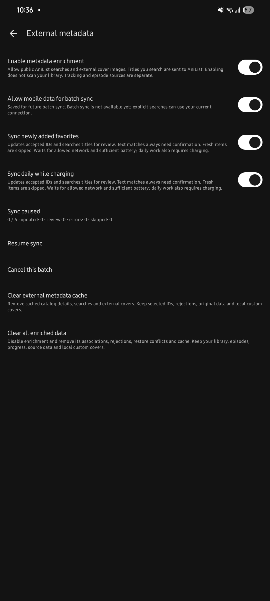
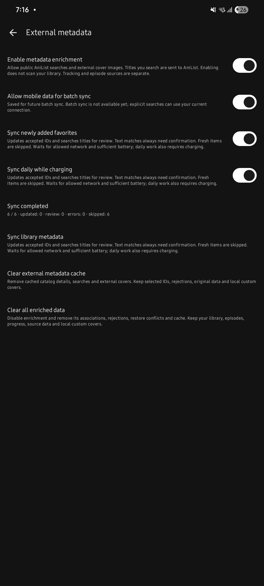

<!-- Yume documentation updated 2026-10-22 with Codex assistance; upstream credits preserved. -->
# Yume


Yume é um fork independente do [Animiru](https://github.com/animiruorg/Animiru), derivado do [Aniyomi](https://github.com/aniyomiorg/aniyomi). Adiciona **metadados e capas AniList opt-in**, com escolha manual, fallback para a capa original e sincronização recuperável. Fontes de episódios e tracking continuam separados desse enriquecimento.

**Experimental, sem release Yume publicada.** Esta documentação descreve o código até `91a378cee` e a revisão documental da sessão 12. No fetch de 22/10/2026, `yume-develop` estava em `25d50a506`; correções e sessões 10–11 estavam na [PR #5](https://github.com/sevenstarr/Yume/pull/5), ainda sem integração. A sessão 12 é local até autorização de envio. Veja [progresso e evidências](docs/PROGRESS.md).

[Compilar e testar](docs/DEVELOPMENT.md) · [Arquitetura](docs/ARCHITECTURE.md) · [Demonstração técnica](docs/DEMONSTRATION.md) · [Origem](docs/UPSTREAM.md) · [Privacidade](docs/PRIVACY.md)

## O que vem do upstream e o que mudou

| Recurso | Origem / contribuição Yume |
| --- | --- |
| Biblioteca, favoritos, categorias, histórico e progresso | Herdados do Animiru e seus antecessores |
| Extensões, fontes, episódios, player e downloads | Herdados; nenhuma fonte ou mídia é fornecida pelo Yume |
| Tracking AniList e outros serviços | Herdado; login/listas remotas não são o novo enriquecimento |
| Busca pública AniList por título, ID ou link aceito | Camada Yume isolada, sem login no tracker |
| Revisão de candidatos e pin manual | Yume; confirmação explícita e proteção contra respostas atrasadas |
| Capas externas e retorno à original | Yume; capa local manual tem prioridade, depois externa aceita e original |
| Persistência e backup de decisões | Yume; tabelas separadas, cache descartável e bloco opcional no backup |
| Lote, novos favoritos e diário opcional | Yume; fila durável, pausa/retomada/cancelamento e quota AniList compartilhada |
| Identidade, updater e correções pontuais | Pacote/marca Yume, updater desligado, correções de locale e metadados locais |
| CI e evidências | Pipeline adaptado e artifacts debug previstos; execução remota atual falhou antes do build por ausência de `sdkmanager` no PATH |

Enriquecimento global, novos favoritos e diário começam **desligados**. Ativar o recurso não varre a biblioteca. A pesquisa textual gera candidatos para revisão; **associação automática por texto permanece desativada**. Banners e troca automática de títulos visíveis ficam fora do MVP.

## Usar o enriquecimento

1. Abra **Configurações → Metadados externos** e leia o aviso de envio de consultas ao AniList antes de ativar.
2. Nos detalhes de um anime, abra **⋮ → Metadados externos**. Pesquise por título, ID AniList ou link oficial aceito.
3. Revise título, ano, formato e temporada. A associação só é gravada após revisar a proposta e confirmar as diferenças.
4. **Atualizar metadados deste anime** renova o ID aceito. **Usar original** mantém o vínculo; **Remover associação** pede confirmação e volta à original.
5. Nas configurações, habilite lote/gatilhos apenas se desejar. Ações manuais usam a conexão atual; lote respeita a preferência móvel e as restrições de energia.

Desligar conserva decisões e biblioteca. Limpar cache externo conserva pins; limpar todos os dados enriquecidos remove vínculos e cache e desliga o recurso. Capas locais manuais e dados herdados têm escopo separado. [Guia detalhado](docs/metadata/manual-review.md) · [Lote atual](docs/metadata/background-sync.md).

## Capturas reais

Capturas históricas da sessão 9, Galaxy A05s/Android 15, antes da identidade visual Yume atual. Mostram lote pausado e concluído com seis itens ignorados por cache/TTL. Os interruptores já estavam ligados pelo usuário; isso **não mostra os defaults**. O texto antigo de dados móveis foi corrigido em `25d50a506`. Não são mockups nem evidência de nova consulta bem-sucedida.

 

[Proveniência, hashes e limites](docs/screenshots/README.md). Capturas atuais de seleção manual/capas e auditoria de acessibilidade permanecem pendentes.

## Instalação e build local

Requer Android **8.0/API 26 ou superior**. Não há download de release Yume recomendado neste estágio. Para avaliação técnica, [compile o snapshot documentado](docs/DEVELOPMENT.md) ou use um artifact de CI do SHA revisado, quando disponível e aprovado. APKs do Animiru não contêm as mudanças Yume.

O build usa JDK **21**, wrapper Gradle **9.7.1**, SDK **37.2**, target **36** e NDK **29.0.14206865**. Após configurar JDK/SDK conforme o guia:

```powershell
./gradlew.bat :app:assembleDebug -Pdist=ci --console=plain --max-workers=2
```

APKs em `app/build/outputs/apk/debug/`. Pacote debug: `io.github.sevenstarr.yume.dev`; release: `io.github.sevenstarr.yume`. São instalações separadas do Animiru e entre si, sem transferência automática de dados. Certificados debug podem variar entre máquinas/CI. Não desinstale um aplicativo com dados pessoais para contornar incompatibilidade de assinatura. [Checksum, assinatura e instalação](docs/BUILD_DISTRIBUTION.md).

## Evidências e limitações

A sessão 11 registrou 306 testes JVM nos relatórios, sem falhas/erros/ignorados, build debug e migrações aprovados e lint com zero erros e avisos remanescentes. Parte dos resultados foi reutilizada pelo Gradle; isso não mede cobertura de linhas nem comprova aceite Android completo. [Relatório de qualidade](docs/TEST_REPORT.md) · [Evidências de CI local](docs/evidence/SESSION_11_COMMANDS.md).

Na consulta remota da sessão 12, a [execução 39877855871](https://github.com/sevenstarr/Yume/actions/runs/39877855871) da PR #5 falhou em **Install required Android SDK**: `sdkmanager: command not found` (exit 127). Testes/build/upload de APK foram ignorados. CI remoto e artifact instalável continuam sem aceite; a correção do ambiente de CI permanece pendente.

Permanecem abertos: restore Android integral, reprodução/download completos e offline, TalkBack, desempenho em biblioteca representativa, bateria/diário natural/deep Doze e atualização de APKs próprios. Testes JDBC com 2.000 itens não medem scroll ou bateria. Updater desligado; OAuth próprio, revisão de provedores/imagens, licenças nativas e assinatura do proprietário são dependências da distribuição. [Pendências](docs/NON_DEVICE_PENDING.md) · [Revisão de provedores](docs/PROVIDER_REVIEW.md).

## Contribuição, autoria e créditos

O mantenedor definiu escopo, nome e identidade, autorizou etapas e decide revisão, integração e publicação. Codex auxiliou análise, implementação, testes e documentação das mudanças Yume, identificadas no histórico e nos avisos. Isso não comprova revisão humana linha a linha nem transfere autoria herdada. O [roteiro técnico](docs/DEMONSTRATION.md) permite avaliar decisões, código e testes.

Leia [CONTRIBUTING](CONTRIBUTING.md), [SECURITY](SECURITY.md), [CHANGELOG](CHANGELOG.md) e o [protocolo](AGENTS.md). Relatos específicos do fork pertencem ao Yume; vulnerabilidades seguem o canal privado em SECURITY.

O texto [Apache-2.0](LICENSE), avisos e histórico upstream foram preservados. [NOTICE](NOTICE) e o [levantamento de licenças](docs/LICENSE_REVIEW.md) distinguem código, componentes nativos e imagens. A licença da raiz não declara licença única para todo APK. Yume não representa Animiru, Aniyomi, Mihon, Tachiyomi ou os provedores.

Avisos preservados do README upstream:

```text
Copyright © 2015 Javier Tomás
Copyright © 2024 Mihon Open Source Project
Copyright © 2024 Aniyomi Open Source Project

Licensed under the Apache License, Version 2.0 (the "License");
you may not use this file except in compliance with the License.
You may obtain a copy of the License at

http://www.apache.org/licenses/LICENSE-2.0

Unless required by applicable law or agreed to in writing, software
distributed under the License is distributed on an "AS IS" BASIS,
WITHOUT WARRANTIES OR CONDITIONS OF ANY KIND, either express or implied.
See the License for the specific language governing permissions and
limitations under the License.
```

Os [README](docs/upstream/README.md) e [créditos de contribuição](docs/upstream/CONTRIBUTING.md) originais permanecem como snapshots. Seus downloads e canais pertencem ao upstream. O aplicativo não hospeda conteúdo nem tem afiliação com provedores de conteúdo.
