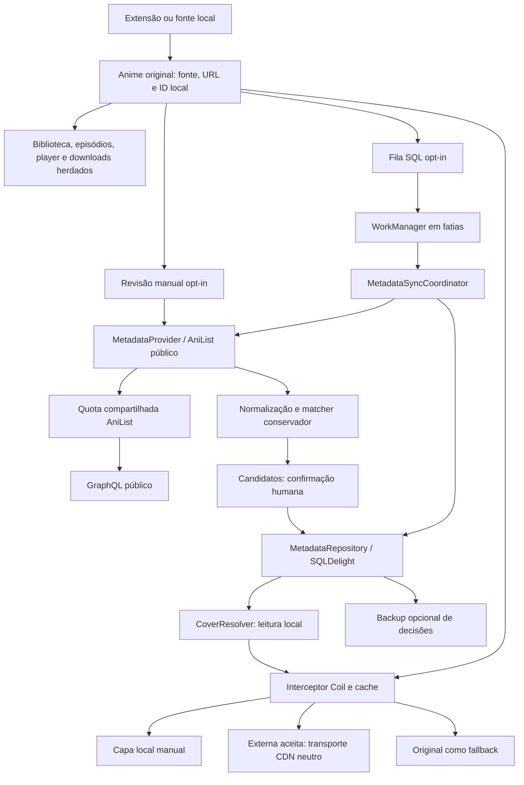

# Arquitetura atual do Yume

22/10/2026, sessão 12. Fontes até `91a378cee`, incluindo correções e sessões 10–11 ainda em revisão na PR #5 no início da sessão. Integração conhecida: `25d50a506`. A [evolução nas sessões 0–11](ARCHITECTURE_HISTORY.md) preserva integralmente as propostas anteriores; suas indicações de trabalho futuro não descrevem necessariamente o estado atual.

## Fluxo e limites

Android/Kotlin/Compose, Voyager e DI Metro são herdados. A camada Yume ocupa `domain`, `data`, `app` e consumidores de capas/widgets existentes, sem novo módulo de fontes.

O diagrama mostra responsabilidades, não cada chamada interna. Rolar listas não inicia pesquisa GraphQL. Biblioteca, episódios, progresso e tracking operam sem habilitar enriquecimento. O cliente público não usa mutations nem OAuth do tracker.

## Contratos e implementações

| Componente | Responsabilidade e fonte |
| --- | --- |
| `MetadataProvider` | `search(MetadataSearch)` e `getById(MetadataId)` retornam `MetadataResult`; [contrato](../domain/src/main/java/tachiyomi/domain/metadata/service/MetadataProvider.kt), [AniList](metadata/anilist-client.md) |
| `AnimeMatcher` | Normalização, evidências/vetos e respeito a pin/rejeições; [fonte](../domain/src/main/java/tachiyomi/domain/metadata/service/AnimeMatcher.kt), [calibração](metadata/anime-matcher.md) |
| `MetadataReviewActions` | Proposta confirmada por ID com revisão/epoch/lease; [serviço](../domain/src/main/java/tachiyomi/domain/metadata/service/MetadataReviewActions.kt), [UI](metadata/manual-review.md) |
| `MetadataRepository` | Opt-in, decisões, snapshots, CAS, limpeza e backup; [contrato](../domain/src/main/java/tachiyomi/domain/metadata/service/MetadataRepository.kt), [persistência](metadata/persistence.md) |
| `CoverResolver` / `CoverPolicy` | Fluxo por IDs ativos e snapshot local imutável, sem provider; [fonte](../domain/src/main/java/tachiyomi/domain/metadata/service/CoverResolver.kt), [Coil](metadata/cover-resolution.md) |
| `MetadataSyncQueue` / `MetadataSyncCoordinator` | Geração, tentativas e itens duráveis; [coordenador](../domain/src/main/java/tachiyomi/domain/metadata/service/MetadataSyncCoordinator.kt), [background](metadata/background-sync.md) |
| `MetadataSyncJob` | Restrições Android e reprogramação entre fatias; [worker](../app/src/main/java/eu/kanade/tachiyomi/data/metadata/MetadataSyncJob.kt) |
| `AniListHostGovernor` | Quota física entre provider, tracker, AniChart e conversão AniSkip; [fonte](../app/src/main/java/eu/kanade/tachiyomi/data/metadata/anilist/AniListHostGovernor.kt) |

Identidade usa ID local e origem `(source, url)`; título não é chave. Namespace do provedor: `anilist`. Payload externo não substitui dados originais/personalizados. Temporada/remake ambíguo exige confirmação. Associação automática textual permanece desativada no produto atual.

## Persistência, concorrência e backup

Schema **150**. Migração aditiva `148.sqm`: 148→149; `149.sqm`: 149→150. Migrações antigas não foram reescritas.

| Estrutura | Conteúdo |
| --- | --- |
| `metadata_control` | Opt-in default off, epoch e prazo de cooldown |
| `anime_metadata` / `metadata_work` | Decisão por anime, payload JSON limitado, revisão/generation e lease/tentativas |
| `metadata_media_cache` / `metadata_lookup_cache` | Snapshots e páginas descartáveis com TTL/limites, separados de pins |
| `metadata_image_index` | Chaves externas para limpeza seletiva do Coil |
| `metadata_restore_pending` | Decisões sem destino único após restore, nunca aplicadas por aproximação |
| `metadata_sync_control` / `metadata_sync_queue` | Geração/estado do lote, gatilhos, itens e tentativas duráveis |

Esquemas: [metadata.sq](../data/src/main/sqldelight/tachiyomi/data/metadata.sq) e [metadata_sync.sq](../data/src/main/sqldelight/tachiyomi/data/metadata_sync.sq). FK e transações protegem relações. Tickets capturam identidade, revisão e epoch; gravações condicionais recusam respostas inválidas. Limpeza, opt-out e cancelamento invalidam trabalho em andamento.

Backup inclui decisões por opção explícita, sem IDs locais de banco, cache, imagens, fila ou opt-in. Restore remapeia por fonte/URL e contexto único; decisões do destino prevalecem, conflitos ficam pendentes e vínculos exigem revalidação. A correção Yume preserva campos `custom*` herdados. Backup não promete carregar bytes de capas manuais. Testes SQL/JVM não substituem restore Android/SAF completo.

## Capas, rede e cancelamento

Precedência normal: **arquivo local manual → externa aceita → original**. Modo original ignora os níveis substitutos para mostrar a fonte; remover vínculo e apagar arquivo manual são ações distintas. O interceptor atende `Anime` e `AnimeCover` antes do keying Coil. Snapshot com revisão/epoch e invalidação reativa protege UI/widgets contra seleção antiga.

CDN externo usa transporte separado, sem headers/cookies/tokens das extensões. Provider e `CoverPolicy` validam URLs. Falha HTTP/decode tenta variantes permitidas e termina no caminho original; offline respeita cache-only. Binários externos ficam no Coil, fora das capas manuais. Preview de candidato é efêmero.

O governor AniList aplica política local de **12 requisições/minuto**, mínimo de cinco segundos e uma emissão em voo até liberar o corpo. Quota/cooldown persistem; ações interativas têm prioridade sobre lote. Isso não garante capacidade em IP compartilhado nem representa o limite contratual atual do serviço. Outros hosts não são limitados por esse governor.

Worker sequencial: até 20 itens por fatia, sem iniciar outro item após três minutos. Tentativas finitas, geração/epoch e recuperação de lease permitem retomada sem sobrescrever pins. Diário exige carga/bateria adequada; lote respeita rede autorizada. [Contrato completo](metadata/background-sync.md).

## Decisões, validação e distribuição

| Decisão | Justificativa / registro |
| --- | --- |
| Camada separada das extensões/tracking | Preservar origem e comportamento herdado; [ADR 0002](DECISIONS/0002-metadata-enrichment-architecture.md) |
| Cliente público e falhas tipadas | Isolar OAuth/rede e permitir mocks; [ADR 0003](DECISIONS/0003-anilist-public-client.md) |
| Matching conservador com revisão | Reduzir trocas de temporada/remake; [ADR 0004](DECISIONS/0004-conservative-anime-matcher.md) |
| Decisões separadas de cache e CAS | Limpeza e concorrência preservando escolha; [ADR 0005](DECISIONS/0005-metadata-persistence.md) |
| Resolver local e fallback Coil | Evitar busca por tile e preservar original; [ADR 0006](DECISIONS/0006-cover-resolution.md) |
| Proposta manual confirmada | Corrigir vínculo sem editar banco; [ADR 0007](DECISIONS/0007-manual-metadata-review.md) |
| Fila durável e quota compartilhada | Recuperação e orçamento entre consumidores; [ADR 0008](DECISIONS/0008-durable-metadata-sync.md) |

CI prepara debug sem secrets e candidato manual em ambiente protegido. Updater desligado; release sem chave própria fica sem assinatura. [Distribuição](BUILD_DISTRIBUTION.md), [identidade](IDENTITY.md) e [privacidade](PRIVACY.md) detalham os limites. A sessão 12 não altera contratos nem cria decisão estrutural nova.

[TEST_REPORT](TEST_REPORT.md) distingue testes locais, caches Gradle e pendências Android; [demonstração](DEMONSTRATION.md) liga cenários a fontes e comandos. TalkBack, performance visual, bateria, restore integral e distribuição continuam com gates próprios. Os documentos por sessão preservam a época; para comportamento consolidado use este arquivo e as atualizações de [PROGRESS](PROGRESS.md).
