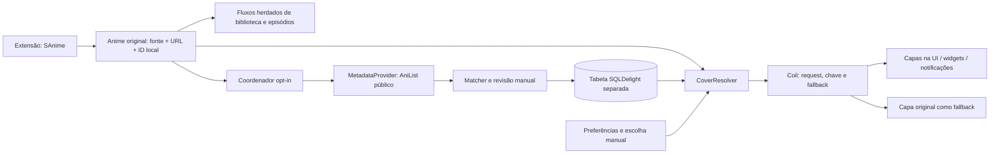

# Arquitetura preliminar — proposta da Sessão 0

**Estado: proposta de metadados, sem implementação e sem ADR de metadados aceito.** Este documento registra a direção técnica solicitada no diagnóstico; não antecipa a especificação/contratos definitivos da Sessão 3. Base: `0b9bb0a347aa7bcee226d8782d98d9abafc34b32`.

Sessão 2 autorizada em 19/10/2026: preparação e verificação do [baseline de build](BUILD_BASELINE.md), sem mudança estrutural ou implementação dos componentes propostos. Os resultados de regressão devem ser consultados antes da especificação da sessão 3.

Atualização da sessão 1 (19/10/2026): nome público confirmado como **Yume**. O [ADR 0001](DECISIONS/0001-local-fork-foundation.md) trata apenas da organização local, branches e preservação de histórico. A [identidade Android](IDENTITY.md) está proposta e ainda não aplicada. A autorização da sessão 1 não equivale à aprovação de contratos definitivos de metadados nem inicia a sessão 3.

## Direção recomendada

Adicionar uma camada de metadados nos módulos existentes `domain`, `data` e `app`. Manter fontes, episódios, progresso, identificadores de origem, `ogTitle`, `thumbnailUrl` e personalizados existentes com a semântica atual. No MVP, os títulos externos servem para pesquisa, identificação e seleção; mudar o título visível automaticamente não faz parte desta proposta.

As setas novas são propostas. Nenhuma foi implementada.

## Componentes e isolamento

| Componente proposto | Local | Responsabilidade |
|---|---|---|
| `MetadataProvider`, modelos de candidatos/associação | `domain/.../metadata/` | Busca por texto e leitura por ID; contrato de dados públicos, sem operações de lista/progresso |
| `AniListProvider` / transporte público | `app/.../data/metadata/anilist/` | GraphQL com OkHttp e Json existentes, DTOs nulos tolerados, timeouts, cancelamento e erros tipados |
| `AnimeMatcher` | `domain/.../metadata/` | Normalização conservadora, candidatos e evidências; sem limiares numéricos arbitrários nesta fase |
| `MetadataRepository` / implementação | `domain` / `data` | Persistência separada, associações manuais, estado, origem, timestamps, cache negativo e limpeza |
| `CoverResolver` | Contrato em `domain`, implementação em `app` | Resolve seleção/revisão e modo original; fornece snapshot imutável à pipeline e fluxo de revisão à UI |
| `MetadataCoverInterceptor`, modelo/keyer de capa resolvida | `app/.../data/coil/` e modelo comum em `domain` | Seleciona request visual; permite fallback inclusive após erro de decodificação |
| `MetadataSyncCoordinator` / novo worker | `app/.../data/metadata/` | Ações explícitas e, mais tarde, lote opt-in, cancelamento, orçamento compartilhado e idempotência |

O novo provider **não chama** `Anilist.bind`, `addLibAnime`, `updateLibAnime` ou autenticação do tracker. A infraestrutura de transporte/DTOs pode compartilhar componentes após uma extração pequena e testada. Preservar o cliente OAuth e suas operações, verificando regressão. O ID de um vínculo AniList existente pode evitar busca textual, mas não autoriza criar/modificar lista no serviço.

Um orçamento compartilhado por host deve abranger tracker, AniChart, conversão AniSkip e novo provider. O interceptor `RateLimitInterceptor` existente é por instância, não basta instanciar mais um. Definir adaptação aos headers e espaçamento contra rajadas; confirmar em testes sem esperar atingir o limite real. Uso inicial abaixo de 30/min, com margem para recursos herdados, é uma política operacional proposta, não garantia de capacidade por IP compartilhado.

## Persistência proposta

Criar `anime_metadata.sq` e uma **nova** migração posterior à `147.sqm` (numeração a reconfirmar no início da implementação). Não editar a migração 147. Nenhuma migração foi escrita nesta sessão.

Modelo preliminar: `anime_id` referenciando `animes._id`, provedor, ID remoto, títulos/sinônimos essenciais, ano/formato/temporada disponíveis, URLs retornadas, seleção de capa, estado, evidências de matching, escolha manual, datas de consulta/atualização, última falha e revisão para invalidar a UI. Guardar identidade de origem `(source, url)` para reconciliação de backup; não usar título como chave.

Permitir uma associação ativa por anime/provedor sem impor unicidade nova aos registros herdados `animes(source,url)`. Associar um mesmo ID remoto a várias fontes locais é válido. Remover um anime pode remover sua associação por FK; remover associação não pode remover anime, episódios ou progresso. Transações e comparação de revisão precisam impedir que uma busca atrasada sobrescreva escolha manual recente.

Backup futuro deve guardar os vínculos como dados opcionais separados e remapear IDs por fonte/URL após restauração. O `BackupAnime.id` atual serve a relações pai/temporada, conforme aviso no código; não transportar esse ID como identidade universal. Não reaproveitar números protobuf reservados. Testar backup antigo sem metadados, novo com metadados, duplicatas e conflitos. Capas binárias não são parte do novo backup proposto; confirmar manutenção das capas manuais existentes separadamente.

## Precedência e comportamento

1. Capa local manual já escolhida no Animiru.
2. Associação/capa externa explicitamente escolhida pelo usuário.
3. Associação automática aprovada pelo matcher com evidência suficiente.
4. Capa original da fonte.

O modo **ver/restaurar original** ignora os níveis externos; a UI deve distinguir remover associação externa de apagar uma capa local manual. Preferência global começa **desligada**. Desligar não apaga a biblioteca nem produz consultas novas. Limpar enriquecimento remove exclusivamente os dados/cache que lhe pertencem e invalida requests. Original significa o recurso atual da fonte/cache; não se promete recuperar um binário que a fonte já removeu e o app não tem em cache.

Estados propostos: desativado, pendente, buscando, associado, ambíguo, não encontrado, erro transitório e indisponível. Um pai com várias temporadas, remake, título curto ou dados insuficientes exige revisão. A primeira posição da busca não é prova de correspondência. Limiar e fixtures serão calibrados na sessão apropriada; não há matching automático implementado.

## Integração Coil e atualização reativa

Registrar a integração em `App.newImageLoader`, atendendo **ambos** os tipos atuais (`Anime` e `AnimeCover`). O interceptor pode resolver associação local de forma suspensa/fora da thread principal; não pode disparar busca GraphQL por item rolado na tela. Um modelo resolvido deve carregar URL original, URL escolhida, ID local, provedor, ID remoto, revisão e modo de bypass. Keyers ficam síncronos, usando esse snapshot, sem I/O de banco em `key()`.

Usar o mecanismo de interceptors do **Coil 3.6.3**, cuja [interface oficial](https://github.com/coil-kt/coil/blob/3.6.3/coil-core/src/commonMain/kotlin/coil3/intercept/Interceptor.kt) e [cadeia oficial](https://github.com/coil-kt/coil/blob/3.6.3/coil-core/src/commonMain/kotlin/coil3/intercept/RealInterceptorChain.kt) foram lidas nesta sessão: `intercept` retorna `ImageResult`, `withRequest` substitui request e `proceed` continua a execução. A proposta é observar erro da tentativa externa e continuar com request da original, com bypass contra recursão e preservação de target/context/size resolver. A API foi verificada no código da versão, mas essa composição ainda precisa de testes reais de cache, cancelamento e decode.

`AnimeImageFetcher` oferece carregamento da fonte e arquivo manual; o ramo externo precisa usar cliente HTTP neutro, **sem `AnimeHttpSource.headers`, cookies arbitrários da fonte ou Bearer OAuth**. Não basta passar a URL AniList às factories atuais, pois `executeNetworkRequest` aplica cliente e headers da extensão.

Capas externas usam o cache Coil existente com chaves distinguindo origem/URL/revisão/bypass; não são gravadas no diretório reservado a capas manuais. A tentativa original mantém seu próprio cache e não deve ser armazenada sob a chave da externa. Não alterar `useBackground(true)` ou thumbnails de episódios: banners ficam fora do MVP.

Além do caminho central, o componente Compose de capa deve observar mudanças de revisão/preferência e reconstruir o request sem reconsulta remota. Invalidar memória apenas no fetcher não provoca recomposição de tiles que já estão na tela. Usar fluxo compartilhado/indexado por ID e leitura em lote para listas; widgets precisam ser atualizados explicitamente após mudança e resolver requests fora da UI. O [mapa](INTEGRATION_MAP.md) inclui requests construídos diretamente e consumidores que recebem apenas uma string de URL.

## Verificações futuras necessárias

- Contratos/matcher/precedência com fixtures ambíguas, títulos em vários alfabetos e temporadas.
- Cliente mockado: sucesso, campos ausentes, GraphQL parcial, erro HTTP, 429/Retry-After, 403, cancelamento e retries finitos.
- Capas: externa ausente, 404, bytes corrompidos (erro de decoder), offline com/sem cache original, bypass, escolha manual, cache limpo e troca de associação com tela aberta.
- Migração/backup ida e volta preservando originais, customizações herdadas, biblioteca, episódios, favoritos, histórico e progresso. Investigar antes o defeito candidato de campos `custom*` no restore herdado.
- Regressão de extensões/player/downloads e performance de scroll em biblioteca grande. Não há promessa de aprovação desses testes nesta sessão.

Aprovação solicitada: direção de isolamento, persistência separada, prioridade manual, opt-in desligado e integração Coil acima. Contratos finais, TTLs, lote automático e alcance visual externo ficam para decisões nas respectivas sessões. Nenhuma decisão estrutural foi marcada como aceita em ADR.
