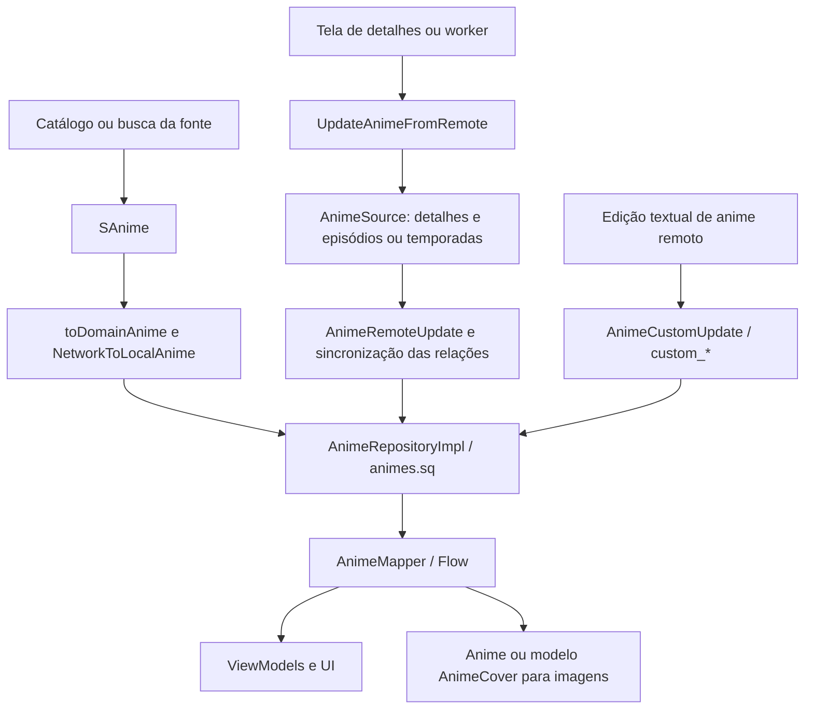
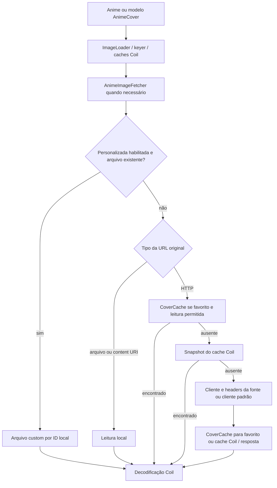

# Arquitetura atual de metadados e capas — análise da Sessão 3

Data: **19/10/2026**, calendário `America/Sao_Paulo`. Documento produzido com assistência do Codex/IA.

**Escopo concluído: somente análise estática da arquitetura existente.** Nenhuma funcionalidade, contrato novo, ADR, dependência, migração ou alteração de comportamento foi implementada nesta etapa. A especificação e a implementação do enriquecimento continuam fora deste documento.

## 1. Referência e método

Inspeção do checkout `Animiru`, a partir de `3f41287549c2ecc38085f6a46bdd549f6593539c` (baseline da Sessão 2). A árvore estava limpa antes da análise. O código dos módulos examinados e `settings.gradle.kts` não apresentam diferenças em relação à base upstream `0b9bb0a347aa7bcee226d8782d98d9abafc34b32`; os commits locais anteriores acrescentam a fundação e o baseline do Yume.

Foram lidos os modelos, contratos de fontes, repositórios, SQL, mappers, ViewModels, fetchers/keyers, cache, widgets, tracking e caminhos de backup citados abaixo. Buscas com `rg` localizaram consumidores e verificaram a ausência dos componentes de enriquecimento propostos. Os links de código são relativos à raiz deste documento (`../../`) e os símbolos indicados permitem reproduzir a leitura.

Os documentos [ARCHITECTURE.md](../ARCHITECTURE.md) e [INTEGRATION_MAP.md](../INTEGRATION_MAP.md) da Sessão 0 são **propostas históricas**, não uma descrição de classes já implementadas. O presente levantamento reconfirma o código e distingue comportamento observado de risco inferido. Os resultados de build/testes anteriores estão em [BUILD_BASELINE.md](../BUILD_BASELINE.md); não foram repetidos nesta mudança documental.

## 2. Visão dos módulos e responsabilidades

Aplicativo Android/Kotlin com UI Compose/Material 3, navegação Voyager e estado em ViewModels/coroutines/Flow. A persistência usa SQLDelight sobre SQLite, e imagens usam Coil 3. O grafo Metro convive com acessos legados via Injekt; o `App` inicializa a ponte `MetroInjektRegistrar`.

| Módulo | Responsabilidade atual relevante | Evidência |
| --- | --- | --- |
| `source-api` | Contrato de extensões/fontes, `SAnime`, atualização combinada de detalhes com episódios ou temporadas | [AnimeSource.kt](../../source-api/src/main/kotlin/eu/kanade/tachiyomi/animesource/AnimeSource.kt), [SAnime.kt](../../source-api/src/main/kotlin/eu/kanade/tachiyomi/animesource/model/SAnime.kt) |
| `domain` | `Anime`, modelo de capa, contratos de repositórios e interactors | [Anime.kt](../../domain/src/main/java/tachiyomi/domain/anime/model/Anime.kt), [AnimeRepository.kt](../../domain/src/main/java/tachiyomi/domain/anime/repository/AnimeRepository.kt) |
| `data` | Esquema/queries/migrações, conversão SQL → domínio, implementação observável dos repositórios | [animes.sq](../../data/src/main/sqldelight/tachiyomi/data/animes.sq), [AnimeMapper.kt](../../data/src/main/java/tachiyomi/data/anime/AnimeMapper.kt), [AnimeRepositoryImpl.kt](../../data/src/main/java/tachiyomi/data/anime/AnimeRepositoryImpl.kt) |
| `app` | Composição, telas, refresh das fontes, edição, cache/fetchers, trackers, workers e backup | [App.kt](../../app/src/main/java/eu/kanade/tachiyomi/App.kt), [AppGraph.kt](../../app/src/main/java/mihon/app/di/AppGraph.kt) |
| `core:common` | HTTP, preferências e utilitários compartilhados; `NetworkHelper` oferece OkHttp, cookies, timeouts e cache HTTP | [NetworkHelper.kt](../../core/common/src/main/kotlin/eu/kanade/tachiyomi/network/NetworkHelper.kt) |
| `core-metadata` | DTOs serializáveis de metadados locais; `AnimeDetails` contém título, autor, artista, descrição, gêneros e status | [AnimeDetails.kt](../../core-metadata/src/main/java/tachiyomi/core/metadata/tachiyomi/AnimeDetails.kt) |
| `source-local` | Leitura/escrita de metadados e imagens no diretório do anime local | [LocalSource.kt](../../source-local/src/main/kotlin/tachiyomi/source/local/LocalSource.kt), [LocalCoverManager.kt](../../source-local/src/main/kotlin/tachiyomi/source/local/image/LocalCoverManager.kt) |
| `presentation-widget` | Consulta de atualizações e preparação de bitmaps para widgets Glance; depende de `domain`, sem dependência de `app` | [build.gradle.kts](../../presentation-widget/build.gradle.kts), [BaseUpdatesGridGlanceWidget.kt](../../presentation-widget/src/main/java/tachiyomi/presentation/widget/BaseUpdatesGridGlanceWidget.kt) |
| `cast` | Entrega metadados de reprodução, inclusive URL da capa, ao Google Cast na variante GMS | [CastManagerImpl.kt](../../cast/src/gms/kotlin/tachiyomi/cast/CastManagerImpl.kt) |

O módulo `core-metadata` **não contém um agregador de provedores externos**. A orquestração atual está distribuída entre `app`, `domain`, `data` e fontes; o nome desse módulo não indica um mecanismo de enriquecimento AniList.

## 3. Identidade e propriedade dos dados

| Informação | Representação e regra encontrada |
| --- | --- |
| Identidade local | `Anime.id` corresponde a `animes._id`. Busca/inserção de um resultado de fonte usa o par `source` + `url`. Não é um ID global AniList. |
| Valores da fonte | Colunas `title`, `author`, `artist`, `description`, `genre`, `status` são mapeadas para `ogTitle`, `ogAuthor`, `ogArtist`, `ogDescription`, `ogGenre`, `ogStatus`. |
| Personalizações textuais | Colunas `custom_*` e propriedades `custom*` no mesmo registro. Os getters efetivos usam `custom* ?: og*`; `null` remove o override. |
| Capa original | `animes.thumbnail_url` → `Anime.thumbnailUrl`; pode ser URL HTTP, arquivo ou URI local. Não há coluna de capa AniList associada. |
| Capa escolhida pelo usuário | Arquivo em `CoverCache`, identificado pelo ID local; sua existência é a indicação de personalização. Não há campo `customCoverUrl` no modelo. |
| Revisão visual | `cover_last_modified` → `coverLastModified`; integra as chaves Coil. Background usa URL, timestamp e cache próprios. |
| Temporadas | `parentId`, `fetchType`, `seasonNumber`, `seasonSourceOrder` preservam relações entre registros locais distintos. Uma capa pertence ao registro solicitado. |
| Tracking | `anime_sync` guarda `anime_id`, `sync_id` (tracker), `remote_id`, título, progresso, score, status, datas e URL de tracking. Não guarda a URL de capa do preview. |

Evidências: [modelo Anime](../../domain/src/main/java/tachiyomi/domain/anime/model/Anime.kt), [mapper](../../data/src/main/java/tachiyomi/data/anime/AnimeMapper.kt), [animes.sq](../../data/src/main/sqldelight/tachiyomi/data/animes.sq), [anime_sync.sq](../../data/src/main/sqldelight/tachiyomi/data/anime_sync.sq), [CoverCache.kt](../../app/src/main/java/eu/kanade/tachiyomi/data/cache/CoverCache.kt).

A query `getAnimeByUrlAndSource` usa `LIMIT 1`, com comentário reconhecendo possíveis múltiplos resultados. O esquema não declara `UNIQUE(source, url)`; `insertNetworkAnime` evita inserir quando o par já existe. Portanto, a identidade é uma convenção operacional de busca/inserção, sem garantia de unicidade por constraint nesse par.

A última migração encontrada é [147.sqm](../../data/src/main/sqldelight/tachiyomi/migrations/147.sqm), que adiciona personalizações e refaz as views de histórico e atualizações. [DatabaseBindings.kt](../../data/src/main/java/tachiyomi/data/DatabaseBindings.kt) configura `tachiyomi.animedb`, adapters e foreign keys. Não há tabela de associação de enriquecimento externo na árvore inspecionada.

## 4. Fluxos de entrada, atualização e observação

### 4.1 Catálogo e pesquisa de fontes

`GetRemoteAnime` escolhe busca, populares ou recentes no `SourceRepository`. O [SourceRepositoryImpl](../../data/src/main/java/tachiyomi/data/source/SourceRepositoryImpl.kt) monta o paging; [BaseSourcePagingSource.load](../../data/src/main/java/tachiyomi/data/source/SourcePagingSource.kt) chama a fonte, converte cada `SAnime` por [toDomainAnime](../../domain/src/main/java/mihon/domain/anime/model/SAnime.kt), deduplica URLs naquela instância e chama [NetworkToLocalAnime](../../domain/src/main/java/tachiyomi/domain/anime/interactor/NetworkToLocalAnime.kt).

`AnimeRepositoryImpl.insertNetworkAnime` executa a operação SQL transacional: insere se o par fonte/URL não existir, atualiza resultados **fora da biblioteca** e retorna os registros locais. Título e capa têm flags baseadas em valores não vazios; detalhes dependem de `initialized`. Um resultado de catálogo não precisa ser favorito para já ter identidade persistida. A busca global também converte e persiste resultados, em [SearchViewModel.kt](../../app/src/main/java/eu/kanade/tachiyomi/ui/browse/source/globalsearch/SearchViewModel.kt).

### 4.2 Refresh de detalhes, episódios e temporadas

[AnimeViewModel.fetchAllFromSource](../../app/src/main/java/eu/kanade/tachiyomi/ui/anime/AnimeViewModel.kt) encaminha a atualização para [UpdateAnimeFromRemote](../../app/src/main/java/mihon/domain/source/interactor/UpdateAnimeFromRemote.kt), escolhendo episódios ou temporadas conforme `fetchType`. Esse interactor resolve a fonte, envia `anime.toSAnime()` e as relações existentes para a API combinada de `AnimeSource`, aplica `AnimeRemoteUpdate` e sincroniza episódios/temporadas em seus caminhos próprios.

Em `awaitUpdateFromSource`:

- O título retornado só é aplicado quando não vazio e o anime não é favorito. Uma atualização de fonte não renomeia automaticamente o título original de um favorito nesse caminho.
- URL de capa vazia não substitui a existente. Se a URL é igual e o refresh não é manual, não há atualização do timestamp da capa.
- Quando precisa atualizar a capa remota, remove o cache da original com `deleteCustomCover = false`. Uma capa personalizada existente é preservada; nesse ramo não avança o timestamp da capa personalizada.
- A query `updateRemote` usa `coalesce` para vários campos, inclusive URLs; `null` mantém o valor persistido. Status, `initialized`, estratégia e `memo` têm atribuições explícitas. As colunas `custom_*` não são escritas nessa query.
- Quando a mudança de título é persistida com sucesso, chama `downloadManager.renameAnime`. Assim, detalhes da fonte também têm efeito em nomes de downloads nesse caso.

`Anime.toSAnime()` usa getters efetivos, inclusive personalizações textuais, enquanto `toDomainAnime` popula os originais. Essa assimetria existe na fronteira atual de fontes; os prefixos `og*` não significam que toda conversão de saída contenha somente dados originais.

O [MetadataUpdateJob](../../app/src/main/java/eu/kanade/tachiyomi/data/library/MetadataUpdateJob.kt) atualiza detalhes **das fontes da biblioteca** com `awaitEpisodesUpdate(fetchDetails = true)`. Agrupa por fonte e limita a cinco grupos concorrentes. Ele não pesquisa candidatos AniList. O [LibraryUpdateJob](../../app/src/main/java/eu/kanade/tachiyomi/data/library/LibraryUpdateJob.kt) atualiza episódios e passa `autoUpdateMetadata` como `fetchDetails`; esse nome também se refere a detalhes da fonte.

### 4.3 Personalização textual e fonte local

Em `AnimeViewModel.updateAnimeInfo`, um anime remoto gera `AnimeCustomUpdate` e `updateCustomInfo` → `updateCustomInformation`. Esse caminho escreve os seis campos `custom_*` diretamente, permitindo limpá-los com `null`. Um anime local atualiza os valores originais, escreve JSON via `LocalSource.updateAnimeInfo` e persiste `AnimeRemoteUpdate`.

`LocalSource.getOldAnimeDetails` lê `details.json` usando `AnimeDetails` e encontra capa/background locais pelos respectivos managers. `LocalCoverManager.find` procura um arquivo de imagem com nome-base `cover`; `update` grava no arquivo encontrado ou cria `cover.jpg` e atualiza o `SAnime.thumbnail_url`. Na obtenção de episódios, `LocalSource` também tenta extrair uma imagem de vídeo quando falta capa. Isso não envolve um serviço externo de metadados.

### 4.4 Do banco até as telas

`AnimeRepositoryImpl` oferece consultas suspensas e `Flow`, com `subscribeToOne`/`subscribeToList` e `AnimeMapper`. `AnimeViewModel` observa anime, episódios e temporadas; `AnimeImageViewModel` observa `GetAnime.subscribe`. Histórico e atualizações recebem projeções com `AnimeCover` e título personalizado, sem precisar carregar o objeto `Anime` inteiro. As views SQL preservam a origem de `thumbnail_url` e o timestamp.

## 5. Pipeline atual de capas

Há dois símbolos chamados `AnimeCover`: o **modelo** em [domain/.../AnimeCover.kt](../../domain/src/main/java/tachiyomi/domain/anime/model/AnimeCover.kt) (`animeId`, `sourceId`, favorito, URL e revisão) e o **componente visual** em [presentation/.../AnimeCover.kt](../../app/src/main/java/eu/kanade/presentation/anime/components/AnimeCover.kt) (enum com formatos e wrapper de `AsyncImage`). O modelo não resolve provedores; o componente aceita `Any?`, incluindo `Anime`, modelo de capa, URL ou `ImageRequest` já construído.

`App.newImageLoader` registra `AnimeImageFetcher.AnimeFactory`, `AnimeCoverFactory`, `AnimeKeyer`, `AnimeCoverKeyer` e o fetcher de rede OkHttp, além do pipeline separado de thumbnails de episódios. Configura memória e paralelismo de fetch/decodificação. O cache Coil em disco é acessado pelo fetcher via `imageLoader.diskCache`; o registro em `App` não declara ali um diretório/tamanho próprios desse cache.

Evidências: [AnimeImageFetcher.kt](../../app/src/main/java/eu/kanade/tachiyomi/data/coil/AnimeImageFetcher.kt), [AnimeCoverKeyer.kt](../../app/src/main/java/eu/kanade/tachiyomi/data/coil/AnimeCoverKeyer.kt), [CoverCache.kt](../../app/src/main/java/eu/kanade/tachiyomi/data/cache/CoverCache.kt), [Utils.kt](../../app/src/main/java/eu/kanade/tachiyomi/data/coil/Utils.kt).

### 5.1 Precedência, armazenamento e falhas

No fetcher, `USE_CUSTOM_COVER_KEY` tem padrão `true`: arquivo personalizado existente precede a URL. Caso contrário, a URL determina arquivo, URI ou rede. URL nula/inválida gera erro; não existe tentativa de outra capa externa. Uma falha de leitura/HTTP/decodificação chega ao resultado de erro do Coil; o componente visual mostra `cover_error`, sem fallback para outro provedor. A existência do arquivo personalizado é verificada antes da decodificação, portanto bytes inválidos não provocam automaticamente nova tentativa com a original.

Para HTTP, um favorito usa primeiro o `CoverCache` quando leitura em disco está permitida, depois snapshot Coil, depois rede. Um snapshot pode ser movido para o `CoverCache` ao carregar um item agora favorito. A resposta vai para o cache de biblioteca se aplicável e gravação permitida; os demais casos tentam o cache Coil e podem consumir diretamente a resposta.

`CoverCache` usa diretórios de arquivos do app, preferindo `getExternalFilesDir`, com fallback interno: `covers` para originais, nomeadas pelo hash da URL; `covers/custom` para personalizadas, nomeadas pelo hash do ID. Esses arquivos são separados do cache HTTP de 5 MiB do `NetworkHelper`. A URL continua no banco mesmo quando a capa apresentada vem de arquivo personalizado.

`executeNetworkRequest` usa `AnimeHttpSource.client` e `headers` da fonte quando disponíveis; senão usa o cliente padrão. A requisição normalmente aplica `noStore` para não ocupar o cache OkHttp. Esse transporte está acoplado à fonte de conteúdo: substituir a URL por um host de metadados dentro desse mesmo caminho poderia carregar também os headers/interceptores da fonte. Essa consequência é inferência do código, sem requisição executada nesta análise.

### 5.2 Chaves e edição manual

`AnimeKeyer` usa `anime;<id>;<coverLastModified>` quando há capa personalizada e `anime;<thumbnailUrl>;<coverLastModified>` nos demais casos. O keyer do modelo de capa aplica a mesma forma com `lastModified`. Background tem ramificações no keyer de `Anime`, com URL/timestamp próprios. As chaves não incluem provedor externo, associação ou revisão externa.

Embora o fetcher respeite `USE_CUSTOM_COVER_KEY`, os keyers decidem pela existência do arquivo sem consultar esse extra. Portanto, pedidos com e sem bypass podem compartilhar chave quando o arquivo existe. A busca encontrou o extra apenas declarado/consumido no próprio fetcher, sem consumidor de bypass no restante do `app`; trata-se de limitação latente, sem reprodução de colisão em execução.

[AnimeImageViewModel](../../app/src/main/java/eu/kanade/tachiyomi/ui/anime/AnimeImageViewModel.kt) e [AnimeExtensions.editCover](../../app/src/main/java/eu/kanade/tachiyomi/util/AnimeExtensions.kt) controlam edição: fonte local grava via `LocalCoverManager`; anime remoto favorito grava no cache personalizado; depois atualiza `coverLastModified` por `UpdateAnime`. Remover a personalizada apaga o arquivo e também atualiza o timestamp. Salvar/compartilhar carrega `Anime` pelo Coil em tamanho original.

## 6. Consumidores e caminhos que exigem tratamento distinto

| Superfície | Dados/pipeline observados | Consequência arquitetural |
| --- | --- | --- |
| Biblioteca: grids/lista | [LibraryCompactGrid](../../app/src/main/java/eu/kanade/presentation/library/components/LibraryCompactGrid.kt), [LibraryComfortableGrid](../../app/src/main/java/eu/kanade/presentation/library/components/LibraryComfortableGrid.kt), [LibraryList](../../app/src/main/java/eu/kanade/presentation/library/components/LibraryList.kt) constroem o modelo de capa e o entregam a `CommonAnimeItem` | Passam pelo fetcher do modelo `AnimeCover`. |
| Detalhes e backdrop | [AnimeInfoHeader](../../app/src/main/java/eu/kanade/presentation/anime/components/AnimeInfoHeader.kt) constrói `ImageRequest.data(anime)`; backdrop adiciona `useBackground(true)` | Capa e background compartilham a factory de `Anime`, com ramos distintos. |
| Histórico/atualizações | [HistoryWithRelations](../../domain/src/main/java/tachiyomi/domain/history/model/HistoryWithRelations.kt), [UpdatesWithRelations](../../domain/src/main/java/tachiyomi/domain/updates/model/UpdatesWithRelations.kt), views SQL | Dependem de projeções/modelo de capa e revisão, não só do ViewModel de detalhes. |
| Diálogo de imagem | [AnimeImagesDialog](../../app/src/main/java/eu/kanade/presentation/anime/components/AnimeImagesDialog.kt) faz requests de `Anime`, alterna background e desabilita cache de memória | Renderização e ações salvar/compartilhar têm requests independentes. |
| Widgets | `BaseUpdatesGridGlanceWidget.prepareData` constrói `AnimeCover`, executa `context.imageLoader.executeBlocking` e gera bitmap | Usa o ImageLoader comum, mas não o componente visual Compose de capa do app; observa dados de atualizações. |
| Notificação de novos episódios | [LibraryUpdateNotifier.getAnimeIcon](../../app/src/main/java/eu/kanade/tachiyomi/data/library/LibraryUpdateNotifier.kt) executa request de `Anime` com recorte circular | Passa pela factory de `Anime` fora de uma tela Compose. |
| Preview de busca do tracker | [TrackerSearch](../../app/src/main/java/eu/kanade/presentation/track/TrackerSearch.kt) passa `TrackSearch.cover_url` | URL direta de candidato; não carrega a capa da biblioteca pelo modelo `AnimeCover`. |
| Discord RPC no player interno/externo | [PlayerActivity](../../app/src/main/java/eu/kanade/tachiyomi/ui/player/PlayerActivity.kt) e [ExternalIntents](../../app/src/main/java/eu/kanade/tachiyomi/ui/player/ExternalIntents.kt) enviam `thumbnailUrl` a `DiscordRPCService` | Esse dado não é escolhido pelo componente de capa nem pelo fetcher de `Anime`. Nesses trechos, o destino é Discord RPC, não uma capa anexada ao intent do player externo. |
| Google Cast (GMS) | `CastManagerImpl` cria `MediaMetadata` com `WebImage(anime.thumbnailUrl)` | URL entregue diretamente ao Cast; não transporta o arquivo personalizado resolvido pelo Coil. |

## 7. AniList existente: tracking e consultas auxiliares

O caminho atual é `TrackInfoDialog`/tela de busca → `TrackerManager`/`Anilist.search` → `AnilistApi` → GraphQL → DTO `ALAnime` → `TrackSearch`. `ALAnime.toTrack` copia a imagem para `cover_url`, e a seleção chama `tracker.register`. O fluxo de vínculo usa `AddTracks`, `InsertTrack` e o repositório de tracking. Não há escrita de `thumbnail_url` nesse percurso de preview/vínculo.

Evidências: [TrackInfoDialog.kt](../../app/src/main/java/eu/kanade/tachiyomi/ui/anime/track/TrackInfoDialog.kt), [AddTracks.kt](../../app/src/main/java/eu/kanade/domain/track/interactor/AddTracks.kt), [TrackRepositoryImpl.kt](../../data/src/main/java/tachiyomi/data/track/TrackRepositoryImpl.kt), [Anilist.kt](../../app/src/main/java/eu/kanade/tachiyomi/data/track/anilist/Anilist.kt), [AnilistApi.kt](../../app/src/main/java/eu/kanade/tachiyomi/data/track/anilist/AnilistApi.kt), [ALAnime.kt](../../app/src/main/java/eu/kanade/tachiyomi/data/track/anilist/dto/ALAnime.kt).

As consultas de busca/detalhes atuais pedem `title.userPreferred` e `coverImage.large`, além de dados para o tracker. Usam `authClient`, cujo [AnilistInterceptor](../../app/src/main/java/eu/kanade/tachiyomi/data/track/anilist/AnilistInterceptor.kt) exige token, valida expiração e adiciona Bearer. O limiter de **25 requisições/minuto é configuração dessa instância**, não um orçamento global nem uma afirmação sobre a política atual do serviço.

[AniChartApi](../../app/src/main/java/eu/kanade/tachiyomi/util/AniChartApi.kt) e [AniSkipApi](../../app/src/main/java/eu/kanade/tachiyomi/ui/player/utils/AniSkipApi.kt) também acessam AniList para horários/conversões de IDs, com instâncias `OkHttpClient()` próprias. Esses caminhos não compartilham o limiter de `authClient` e não implementam enriquecimento de capas.

## 8. Backup e restauração

O fluxo é `AnimeBackupCreator.toBackupAnime` → `BackupAnime` serializado em protobuf → `AnimeRestorer` → `RestoredAnime` → `RestoreRepositoryImpl`. A restauração procura o par fonte/URL, insere ou mescla o registro e restaura episódios, histórico, tracking e categorias em transação. O `BackupAnime.id` está explicitamente reservado à associação pai/temporadas; não é identidade universal para outros vínculos.

O creator serializa os valores originais, URLs de capa/background e campos `custom*`. Entretanto, `BackupAnime.getAnimeImpl()` reconstrói o `Anime` sem copiar `custom*`; as queries de inserção/`updateFromBackup` examinadas também não escrevem essas colunas. Há, portanto, risco concreto de perda de personalizações do backup, identificado por leitura e **não reproduzido em restore real**. O `customStatus` do backup ainda representa ausência por `0`, enquanto o domínio usa nullable.

Não foi encontrado transporte dos binários de capas personalizadas nesse fluxo; o campo protobuf antigo `customCover` está comentado como não usado. Restaurar URLs/metadados não comprova restaurar arquivos de `covers/custom` ou imagens da biblioteca local.

Evidências: [AnimeBackupCreator.kt](../../app/src/main/java/eu/kanade/tachiyomi/data/backup/create/creators/AnimeBackupCreator.kt), [BackupAnime.kt](../../app/src/main/java/eu/kanade/tachiyomi/data/backup/models/BackupAnime.kt), [AnimeRestorer.kt](../../app/src/main/java/eu/kanade/tachiyomi/data/backup/restore/restorers/AnimeRestorer.kt), [RestoreRepositoryImpl.kt](../../data/src/main/java/tachiyomi/data/backup/RestoreRepositoryImpl.kt).

## 9. Limitações e questões documentadas

| Limitação observada ou risco inferido | Efeito / limite da conclusão |
| --- | --- |
| Não há camada de enriquecimento externo implementada | Buscas nos fontes de `app`, `domain`, `data`, `core-metadata`, `source-local` e widgets não encontraram `MetadataProvider`, `MetadataRepository`, `AnimeMatcher`, `CoverResolver`, `ResolvedCover` ou `anime_metadata`. Os nomes nos documentos anteriores são propostas. Não há matching, associação de capa externa, estado de revisão nem opt-in desse enriquecimento nesses caminhos. |
| Originais e overrides têm semânticas específicas | Escrever metadados externos nos originais, em `custom_*` ou em `anime_sync` confundiria responsabilidades já existentes. Essa é uma implicação arquitetural, sem escolha de contrato novo nesta etapa. |
| Fontes têm dados e identidades heterogêneos | `SAnime` oferece texto, status e imagens opcionais, sem contrato normalizado de IDs externos/ano/formato para matching. Fonte/URL não une automaticamente duplicatas entre extensões. `memo` é JSON de fonte, não uma associação externa tipada. |
| Persistência não garante unicidade fonte/URL por constraint | A busca usa `LIMIT 1`; deduplicação e associação entre fontes não podem pressupor uma chave global já existente. |
| Capas dependem de cache, timestamp e tipo do request | Alterar só um composable não alcança widgets, notificações, URLs diretas, ações de imagem e Cast. Chaves atuais não representam seleção externa; bypass de personalizada não é distinguido pelos keyers. |
| Falhas de imagem não têm cadeia de fallback | Capa ausente, arquivo corrompido ou erro de rede/decoder não seleciona automaticamente outra origem. Não foram testados HTTP 404, offline ou bytes inválidos em execução. |
| Cliente de imagem usa contexto da fonte | Headers/interceptores da fonte podem acompanhar uma URL substituída. Separação entre host externo e transporte da extensão não existe como política de enriquecimento. |
| AniList atual é orientado a tracking autenticado | O preview usa `large`; não há seleção `extraLarge` ou associação independente de login para capas da biblioteca. A análise descreve o cliente local e não revalida disponibilidade, termos ou limites públicos da API. |
| Consultas AniList têm clientes separados | O limiter do tracker não coordena AniChart/AniSkip. Não foi medido tráfego agregado, retry, backoff ou comportamento sob 429. |
| Metadados locais têm nomes de arquivo inconsistentes | `LocalSource.updateAnimeInfo` escreve em `details.json` se já existe, mas cria `info.json` quando não existe; `getOldAnimeDetails` procura apenas nome-base `details`. A edição pode não ser relida nesse segundo caso. Achado estático, sem reprodução. |
| Ação salvar/compartilhar difere do preview de background | `AnimeImagesDialog` aplica `useBackground(page == 1)`, mas `AnimeImageViewModel.saveImageInternal` não aplica `useBackground`, embora altere o nome conforme a página. Há risco de exportar capa com nome de background. Achado estático, sem correção nesta etapa. |
| Backup não demonstra round-trip das personalizações/imagens | Omissões `custom*` e ausência de binários no fluxo exigem validação própria antes de concluir preservação de dados. |
| Cobertura de testes específica não foi localizada | A listagem encontrou seis classes de testes unitários no `app`/`domain`, sem testes dedicados a capas, AniList, metadados locais ou round-trip de `BackupAnime`. Não significa ausência de qualquer validação indireta; o baseline anterior não prova esses fluxos. |

## 10. Validação e ponto de parada

Nesta etapa foram realizadas leitura estática, busca de símbolos/consumidores, conferência de caminhos e revisão do diff documental. A comparação Git com a base upstream confirmou a ausência de mudanças nos módulos analisados antes desta documentação. A última migração foi conferida pela listagem dos arquivos `*.sqm`.

Não foram executados aplicativo, build, testes Android, requisições AniList, restauração, migrações ou testes visuais nesta etapa. Comportamentos descritos como riscos continuam hipóteses sustentadas pelo código, sem reprodução em dispositivo. O levantamento não audita o código de extensões distribuídas externamente nem garante inventário de toda imagem exibida pelo app.

**Ponto de parada:** análise da Sessão 3 registrada. Permanecem para autorização/etapas próprias a definição de contratos e decisões arquiteturais, persistência de associações, matching, integração pública AniList, resolução/fallback de capas, UI e validação em execução. Este documento não aprova nem implementa as propostas anteriores.
