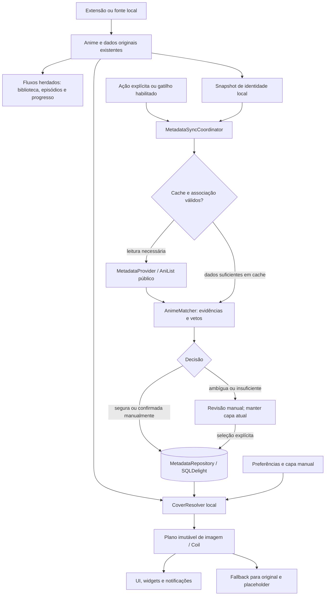

# Arquitetura proposta para enriquecimento de metadados

Data: **19/10/2026**, calendário `America/Sao_Paulo`. Trabalho assistido pelo Codex/IA.

**Status: proposta da Sessão 3 para revisão; sem implementação e sem aceite presumido.** Base: `4fdc01724`, que registra a análise da Etapa A em [current-architecture.md](current-architecture.md). Os requisitos da Sessão 3 do prompt mestre são consolidados como critérios na seção 1, para que a proposta não dependa de um arquivo pessoal externo ao repositório. Este documento substitui a direção preliminar da [Sessão 0](../ARCHITECTURE.md) nos assuntos de metadados; os comportamentos herdados continuam descritos na Etapa A. O [ADR 0002](../DECISIONS/0002-metadata-enrichment-architecture.md) resume as decisões para revisão.

## Navegação

- [1. Objetivo, requisitos e invariantes](#1-objetivo-requisitos-e-invariantes)
- [2. Componentes e contratos](#2-componentes-e-contratos)
- [3. Provedores e transporte](#3-provedores-e-transporte)
- [4. Identidade, matching e ambiguidades](#4-identidade-matching-e-ambiguidades)
- [5. Estados e controle do usuário](#5-estados-e-controle-do-usuário)
- [6. Persistência, concorrência, migração e backup](#6-persistência-concorrência-migração-e-backup)
- [7. Cache e invalidação](#7-cache-e-invalidação)
- [8. Capas, qualidade e fallback](#8-capas-qualidade-e-fallback)
- [9. Integração com o Animiru](#9-integração-com-o-animiru)
- [10. Coordenação, limites e erros](#10-coordenação-limites-e-erros)
- [11. Alternativas e consequências](#11-alternativas-e-consequências)
- [12. Validação e entrega futura](#12-validação-e-entrega-futura)
- [13. Evidências e limitações desta proposta](#13-evidências-e-limitações-desta-proposta)

## 1. Objetivo, requisitos e invariantes

O Yume adicionará uma camada local e opt-in que identifica um anime em um catálogo externo e resolve sua capa, preservando os dados e fluxos do Animiru. O primeiro provedor será AniList. Títulos alternativos, ano e formato servem à identificação e à revisão; a aplicação automática de sinopse, título, gêneros, status ou banner fica fora do MVP.

| Requisito da Sessão 3 | Decisão verificável |
| --- | --- |
| Título/atributos → normalização → busca → confiança → vínculo → persistência → capa com fallback | Fluxo e contratos na seção 2; decisões de matching na seção 4 |
| `MetadataProvider`, `AniListProvider`, `AnimeMatcher`, `MetadataRepository`, `CoverResolver`, `MetadataSyncCoordinator` | Responsabilidades e fronteiras explícitas, sem criar módulos desnecessários |
| Chave local estável, provedor, ID remoto, título selecionado, URLs, qualidade/origem, estado, datas, preferência manual e última falha | Associação e snapshots separados nas seções 6 e 7 |
| Escolha manual > associação automática confirmada > original | Precedência incluindo as capas manuais já existentes, na seção 8 |
| Desativado, pendente, buscando, associado, ambíguo, não encontrado, erro transitório e indisponível | Estados derivados de associação, operação e disponibilidade, na seção 5 |
| ADR, contratos, plano de migração e estratégia de testes | Este documento e ADR 0002 propostos; aprovação e execução futura não são declaradas concluídas |

Invariantes obrigatórios:

1. Enriquecimento não escreve em `animes.thumbnail_url`, `og*`, `custom_*`, `memo`, episódios, downloads, histórico ou progresso. Não chama `UpdateAnimeFromRemote` para aplicar dados externos e não modifica o contrato `SAnime`.
2. `Anime.id` identifica um registro local. `(source, url)` é a identidade operacional da fonte; título não é chave. Não existe no esquema atual uma constraint de unicidade para esse par.
3. Nenhum resultado ambíguo substitui automaticamente a capa. A posição na busca, popularidade ou uma imagem atraente não comprovam identidade.
4. Escolhas manuais são fixadas até ação explícita; uma atualização, expiração de cache ou troca de tracker não muda o ID fixado.
5. Desligar impede novas operações de enriquecimento e uso visual externo. Limpar remove somente dados/cache pertencentes à camada. Biblioteca, fontes e capas manuais continuam com suas regras herdadas.
6. Renderizar uma capa nunca inicia pesquisa GraphQL. Uma falha externa não bloqueia abrir a biblioteca, carregar episódios ou reproduzir.

## 2. Componentes e contratos

Reutilizar Kotlin, coroutines/Flow, SQLDelight, OkHttp, Kotlin Serialization, Metro, Compose e WorkManager já presentes. Não introduzir backend próprio, banco paralelo ou SDK de catálogo no MVP. Os nomes abaixo são **contratos propostos em prosa**, não classes já existentes nem código a gerar nesta etapa.

| Componente / módulo | Entrada e saída lógica | Responsabilidade e limite |
| --- | --- | --- |
| `MetadataProvider` / contrato em `domain` | `search(query, filters, page)` → página de candidatos; `getById(providerId)` → registro ou erro tipado | Dados públicos e capabilities do provedor. IDs opacos e namespaced. Sem UI, SQL, autenticação de tracker ou escrita de listas |
| `AniListProvider` / `app/.../data/metadata/anilist` | Operações anteriores → GraphQL → DTOs → modelo do domínio | Sanitizar respostas, tratar nulos, paginação e erros parciais; somente queries públicas |
| `AnimeMatcher` / `domain/.../metadata` | Snapshot local + candidatos + rejeições + versão de política → decisão e evidências | Função determinística sem rede, banco ou alteração de fonte. Retorna associação elegível, revisão, insuficiente ou nenhum candidato |
| `MetadataRepository` / contrato `domain`, implementação `data` | Observar por ID/em lote; ler cache; confirmar escolha; rejeitar; remover; limpar; atualizar com revisão esperada | Transações, integridade, versões, política local e estado durável. Separa tentativa de sincronização de vínculo aceito |
| `CoverResolver` / contrato `domain`, implementação `app` | Anime/capa local + associação + preferências + disponibilidade local → `ResolvedCover`; observação de revisões | Somente leitura local. Produz plano de tentativas, não pesquisa nem faz download |
| `MetadataSyncCoordinator` / `app/.../data/metadata` | ID local + motivo + política de rede → progresso e resultado | Cache, deduplicação, busca, matching, gravação condicional, cancelamento e orçamento HTTP |
| `MetadataSyncJob` / `app`, futuro | Trabalho único e fila persistida → chamadas ao coordenador | WorkManager, restrições Android e retomada. Independente dos jobs de atualização de fontes |
| Interceptor, modelos/fetchers e keyers de capa / `app/.../data/coil` | `ResolvedCover` → tentativa manual/externa/original → `ImageResult` | Transporte correto por origem, cache por tentativa, fallback após fetch **ou decode**, sem alterar modelos originais |

Objetos de fronteira:

- **`LocalAnimeIdentity`**: `animeId`, `sourceId`, URL exata, `ogTitle`, relação pai/temporada, escopo (`SINGLE_ENTRY` ou `COLLECTION`), atributos opcionais com procedência/confiabilidade e fingerprint. `customTitle` só entra se o usuário o escolher como consulta manual. Não serializar `memo` arbitrário nem enviar URL da fonte ao catálogo.
- **`MetadataCandidate` / `MetadataMedia`**: provedor, ID, tipo de mídia, títulos por idioma, sinônimos, datas parciais, ano de lançamento, formato, temporada de lançamento, contagem de episódios opcional, relações relevantes e variantes de capa com qualidade nominal. Ausência é `null`/desconhecido; enum desconhecido não vira um formato presumido.
- **`MatchDecision`**: candidatos ordenados, evidências por sinal, conflitos, completude da pesquisa, versão de normalização/matcher, classe de confiança e motivo legível. Score é medida de ranking, não probabilidade estatística.
- **`MetadataAssociation`**: identidade local, provedor/ID aceito, título selecionado como rótulo, origem da decisão (`MANUAL`, `VERIFIED_TRACKER_ID`, `AUTO_MATCH`), fixação manual, datas, evidências, fingerprint e revisão.
- **`ResolvedCover`**: ID/fonte local, original e revisão original, referência manual, provedor/ID externo, variantes selecionadas, revisões de associação/cache/política, modo de exibição e lista ordenada de tentativas. Snapshot imutável: fetcher e keyer consomem a mesma decisão.
- **`MetadataFailure`**: categoria, provedor, operação, HTTP/GraphQL code opcional, `retryable`, `occurredAt`, `nextRetryAt` e mensagem sanitizada. Cancelamento de coroutine continua cancelamento, sem virar erro de negócio.

O repositório oferece leitura observável por lote e gravações com `expectedRevision`, `expectedGeneration`, `inputFingerprint` e `cleanupEpoch`. A UI recebe estados do domínio, sem depender dos DTOs GraphQL. Widget pode consumir o contrato em `domain` sem depender do módulo `app`.

## 3. Provedores e transporte

### 3.1 Comparação e decisão

| Alternativa | Benefício | Custo/risco para este produto | Decisão |
| --- | --- | --- | --- |
| AniList público | Catálogo de anime; IDs, títulos alternativos, atributos e capas; contexto já conhecido no tracker herdado | Quota restrita, campos opcionais, granularidade própria de obras e termos que precisam ser respeitados | Único adapter do MVP, separado do tracker |
| Kitsu | API JSON:API documenta títulos, subtipo, datas e `posterImage` | Exige adapter, política de identidade e revisão de termos próprias; não resolve automaticamente diferenças entre catálogos | Candidato futuro; nenhum tráfego ou fallback automático no MVP. [Documentação oficial](https://kitsu.docs.apiary.io/reference/posts) |
| TMDB | Busca de TV e modelo explícito de temporadas/posters | Converter série/temporada TMDB em obra/cour AniList adiciona reconciliação; não assumir equivalência de IDs ou numeração | Fora do MVP. Essa inadequação relativa é uma inferência arquitetural a partir do [modelo de temporada](https://developer.themoviedb.org/reference/tv-season-details) |
| Reusar a API autenticada do tracker AniList | Menos DTOs iniciais | Acopla capa pública a token, busca e operações de lista; cliente atual usa `large` e limiter por instância | Rejeitado como contrato de enriquecimento; compartilhar apenas infraestrutura adequada |
| Agregador/backend com vários catálogos | Poderia centralizar chaves e quotas | Novo serviço, armazenamento central, operação, privacidade e reconciliação de identidades | Rejeitado no MVP |

Cada adapter futuro declara capacidades, formatos suportados, política de imagens, orçamento e termos. `(provider, remoteId)` é a identidade externa; `anilist:123` e outro provedor com ID `123` são registros distintos. Ausência/falha de AniList não autoriza pesquisar outro catálogo ou trocar de associação. Adicionar provedor exige uma decisão própria; a interface extensível não significa integração já implementada.

### 3.2 Contrato AniList

Usar `POST https://graphql.anilist.co`, com variáveis GraphQL e operações públicas fixas, sem Bearer, login ou mutation. A documentação informa que dados públicos dispensam OAuth e apresenta esse endpoint. [Guia oficial](https://docs.anilist.co/guide/migration/version-1/)

- Pesquisa: `Page(page, perPage: 20)` com `media(search, type: ANIME)` e `pageInfo`. Filtros só quando a origem tiver evidência confiável; ausência local não significa filtro negativo.
- Leitura exata: `Media(id, type: ANIME)`. Um `idMal` explicitamente conhecido pode ser consultado por esse argumento, sem tratá-lo como ID AniList. Os argumentos e paginação estão na [referência de queries](https://docs.anilist.co/reference/query).
- Seleção de campos: `id`, `idMal`, `type`, `title { romaji english native }`, `synonyms`, `format`, `startDate`, `season`, `seasonYear`, `episodes`, `siteUrl` e `coverImage { extraLarge large medium }`. Relações e seus tipos entram na leitura de detalhes quando necessários para distinguir versões; não se percorre a franquia inteira. [Esquema Media](https://docs.anilist.co/reference/object/media)
- `season` significa estação de lançamento, como inverno/verão; **não é o número da temporada narrativa**. Usar título, relações e dados locais para distinguir sequel/cour. Datas parciais não se completam artificialmente.
- ID e tipo válidos são necessários para aceitar registro. Resposta sem títulos utilizáveis não sustenta matching textual. Capa ausente não torna a identidade inválida: pode haver vínculo associado usando a original.
- `data` com `errors` é sucesso parcial: guardar apenas campos íntegros. Erro em ID/tipo/títulos ou em parte da lista impede declarar pesquisa completa e associação textual automática. Erro só em capa mantém identidade e ativa fallback. Resultado truncado não vira “não encontrado”.

O cliente público reutiliza bibliotecas e configuração de rede pertinente, mas não herda cegamente o `NetworkHelper.client`, que tem cookie jar e interceptores de fonte/Cloudflare. Construir transporte neutro com configuração de proxy/DNS/TLS aplicável, sem cookies de extensões, interceptor OAuth ou headers de `AnimeHttpSource`. O cliente OAuth permanece separado. Ambos participam do orçamento comum do host GraphQL; imagens CDN têm controle de concorrência próprio.

URLs externas devem ser HTTPS, sem credenciais embutidas e em hosts de imagem permitidos pelo adapter, inicialmente `s4.anilist.co` e `s1.anilist.co` como configuração a validar com respostas oficiais antes da implementação. Validar também cada redirect; host novo exige atualização explícita da política. Não reescrever caminhos para inventar tamanhos nem aceitar URLs de fonte, arquivo/content URI ou endereços locais como capa externa. Arquivos/URIs legítimos da fonte original continuam no carregador herdado.

### 3.3 Uso e retenção

Os [termos AniList](https://docs.anilist.co/guide/terms-of-use) vedam coleta massiva, uso como backup/armazenamento e serviços concorrentes não complementares, incluindo dados de mídia. A proposta limita consultas a itens usados pelo usuário e mantém cache limitado, sem espelhar catálogo ou incluir imagens no APK/Git. Isso é mitigação técnica, **não comprovação de permissão para o produto**. O enquadramento do Yume e a retenção proposta precisam ser confirmados antes de distribuição em escala, como já registrado na auditoria. Nenhum contato externo faz parte desta etapa.

## 4. Identidade, matching e ambiguidades

### 4.1 Três identidades distintas

1. **Local:** FK para `animes._id`. Vínculo pertence ao registro solicitado, inclusive uma temporada filha.
2. **Fonte:** `(sourceId, url exata)` e contexto pai/temporada. Preservar URL fornecida, sem retirar query ou normalizar caminhos que podem diferenciar itens. Esse par auxilia restauração; pode ser duplicado e não une extensões.
3. **Catálogo:** `(provider, remoteId)`, correspondente a uma obra/lançamento, não necessariamente a uma franquia inteira.

Várias fontes locais podem apontar para o mesmo registro externo; isso compartilha cache remoto, sem mesclar biblioteca, episódios ou progresso. Uma coleção que reúne várias temporadas não recebe automaticamente a capa de uma obra filha. Não copiar associação de pai para filhos nem deduzir que `seasonNumber = 2` corresponde ao segundo vizinho de uma relação AniList.

### 4.2 Ordem de resolução

1. Ler opt-in, política por anime, rejeições e associação existente. `ORIGINAL_ONLY` encerra resolução externa; uma associação manual válida apenas renova detalhes do **mesmo ID**.
2. Verificar vínculo já aceito. Validade da identidade não expira com o TTL do snapshot. Mudança material na origem suspende uso de associação automática para revisão; não a troca por outra silenciosamente.
3. Se houver ID AniList no tracking do mesmo `animeId`, consultá-lo publicamente. A origem desse vínculo e os conflitos disponíveis precisam ser conhecidos. Apenas um vínculo com evidência de seleção humana, ID/tipo verificados e sem conflito explícito pode ser aceito como `VERIFIED_TRACKER_ID`. Se a origem manual não for demonstrável, apresentar como candidato, sem promovê-lo por confiança implícita. Enriquecimento nunca escreve no tracking.
4. Sem ID seguro, pesquisar por títulos conservadoramente normalizados. Um ID de outro catálogo só ajuda se o adapter oferecer uma conversão explícita verificada; não usar números encontrados em URL, descrição ou `memo` como IDs confiáveis.
5. Ranqueamento local, vetos e completude determinam associação elegível, revisão ou ausência. Persistir o vínculo só depois da decisão e da checagem de revisão/generation.

Mudanças posteriores no tracking não sobrescrevem associação manual nem associação já aceita. Um conflito gera aviso e revisão. Em uma nova pesquisa solicitada para corrigir um vínculo existente, os resultados são uma **proposta de substituição**; manter o vínculo anterior até confirmação.

### 4.3 Normalização conservadora

- Preservar texto bruto para auditoria. Comparação principal usa Unicode NFC, caixa independente de locale, espaços equivalentes e pontuação normalizada sem apagar tokens. Uma variante NFKC pode auxiliar largura de caracteres, conservando os tokens originais como evidência.
- Criar variante adicional removendo apenas sufixos de distribuição ancorados e conhecidos (`legendado`, `dublado`, `HD`, resolução), mediante regras versionadas. Não retirar palavras no meio do título nem remover indiscriminadamente parênteses.
- Preservar números, anos, `II`, `Part 2`, `2nd Season`, `Final`, `Movie`, `OVA`, `Special` e subtítulos. Conversões de numerais só em contexto de temporada reconhecido. Nunca converter um número do nome da obra em temporada por padrão.
- Comparar romaji, inglês, nativo e sinônimos sem presumir que tradução livre ou transliteração são equivalentes. Remoção de acentos/transliteração é sinal auxiliar de recuperação, sem sustentar sozinha associação automática. Não usar tradução automática ou modelo generativo para decidir identidade.
- `SAnime` não fornece ano/formato/ID externo padronizados. Atributos inferidos do título têm confiabilidade menor; um token como “2024” não vira data oficial. Não derivar total de episódios da lista incompleta da extensão.

### 4.4 Candidatos e orçamento de pesquisa

Consultar no máximo duas variantes determinísticas por tentativa automática: título conservado e variante sem sufixo de distribuição, se distinta. Cada variante tem até duas páginas de 20, total máximo de quatro operações de busca e 80 candidatos antes da deduplicação por ID. Uma leitura de detalhes do melhor candidato pode completar sinais: **máximo cinco operações lógicas por resolução textual**. Com até duas novas tentativas por operação, o teto é 15 emissões HTTP, sujeito ao deadline e ao orçamento comum; não consumir todo esse teto é o caso esperado. Caminho por ID exige uma operação, com até três emissões contando retries.

Se ainda houver `hasNextPage`, erro parcial ou orçamento insuficiente, a pesquisa é incompleta e não admite associação textual automática, mesmo com um único candidato visível. A UI oferece continuação paginada explícita e busca editável, respeitando rate limit. Não preencher faltas de dados com suposições para diminuir chamadas.

### 4.5 Evidências, vetos e faixas de confiança

O matcher calcula ranking a partir da melhor comparação entre títulos, compatibilidade de ano/data, formato e marcadores de edição/temporada. Registrar sinais ausentes separadamente de sinais concordantes; título exato sem contexto não equivale a todos os atributos confirmados. Não considerar gênero, popularidade ou quantidade de episódios assistidos como prova de identidade.

| Sinal/caso | Política |
| --- | --- |
| ID explicitamente escolhido e detalhes confirmam `ANIME` | Aceitável sem busca textual; conflitos de edição continuam visíveis |
| Formato confirmado incompatível, como filme versus série | Veto à associação automática; mostrar diferença na seleção manual |
| Temporada/parte explicitamente diferente | Veto automático; ausência desse atributo no remoto não conta como concordância |
| Ano confiável incompatível | Veto automático; datas desconhecidas ou inferidas exigem revisão, sem tolerância universal de ±1 ano |
| Remake, recap, compilação, especial, OVA ou cour com título semelhante | Comparar edição, data e relações; se não distinguível, revisão |
| Título curto/genérico, só sigla ou só tradução aproximada | Sem associação textual automática sem evidência independente forte |
| Item local representa coleção/franquia | Sem associação automática a obra única; permitir seleção manual com aviso de escopo |
| Candidato rejeitado pelo usuário | Excluir de futuras decisões automáticas daquele anime; reexibir apenas mediante ação manual |
| Candidatos próximos ou empatados | Revisão, mesmo se o primeiro tiver score alto |

Faixas de confiança:

- **Alta:** sem vetos, pesquisa completa, contexto suficiente, score acima do limiar validado e margem validada para o segundo candidato. Pode gerar `AUTO_MATCH` somente após calibração.
- **Intermediária:** candidato plausível com contexto insuficiente, empate, risco de edição ou pesquisa incompleta. Estado `AMBIGUOUS`; não muda a capa.
- **Baixa:** evidências fracas ou incompatíveis. Não associar; permitir pesquisa manual. Distinguir `INSUFFICIENT_EVIDENCE` de busca completa sem candidatos (`NOT_FOUND`).

**Não definir pesos, percentuais ou limiares numéricos por palpite.** A Sessão 5 deve calibrá-los com fixtures rotuladas e um conjunto de validação separado, incluindo falsos candidatos deliberados. A configuração versionada precisa registrar pesos, limiar alto, limiar de revisão, margem mínima e regras de suficiência. Até essa calibração, a associação automática por texto permanece desabilitada; seleção manual e verificação de ID continuam possíveis. Qualquer associação automática sabidamente errada nas fixtures bloqueia a ativação; medir também cobertura e abstenção para evitar aprovar um matcher que simplesmente nunca associa.

### 4.6 Revisão manual

Mostrar título original e todos os títulos relevantes do candidato, ano/data, formato, edição/parte, provedor, ID/link público e miniatura. Exibir sinais de conflito ou ausência; não chamar score de “percentual de certeza”. Oferecer selecionar, rejeitar, editar busca, informar ID/link oficial validado e manter original. Não pré-selecionar um candidato ambíguo como confirmação implícita.

A escolha grava `MANUAL` e fixação atômica. Ela pode superar conflito de título/ano/formato após aviso explícito, mas nunca aceitar tipo não anime, ID inválido ou URL insegura. Um erro de rede durante a validação não cria vínculo novo não verificado. Atualizações futuras renovam apenas os detalhes do ID fixado. A preferência manual de variante de capa, quando houver, precede a variante automática desse mesmo registro.

## 5. Estados e controle do usuário

Separar três dimensões: **vínculo aceito**, **última operação** e **saúde do provedor/imagem**. Um vínculo associado pode ter cache vencido ou falha de capa; não apagar a associação para representar uma tentativa que falhou.

| Estado exibido | Condição e transição |
| --- | --- |
| Desativado (`DISABLED`) | Global off ou provedor desativado; encobre estado persistido, cancela fila e ignora camada externa |
| Pendente (`PENDING`) | Elegível, sem resolução terminada ou aguardando restrição/orçamento; não iniciar por scroll |
| Buscando (`SEARCHING`) | Tentativa com generation/lease vigente; mantém vínculo anterior, se houver |
| Associado (`ASSOCIATED`) | ID aceito por regra válida ou seleção manual; pode usar capa original se imagem faltar |
| Ambíguo (`AMBIGUOUS`) | Mais de um resultado plausível ou evidência insuficiente; nenhuma substituição automática |
| Não encontrado (`NOT_FOUND`) | Busca completa e válida sem candidato elegível; aplica cache negativo |
| Erro transitório (`TRANSIENT_ERROR`) | Rede, timeout, 429 ou falha temporária, com próxima tentativa; vínculo prévio continua válido |
| Indisponível (`UNAVAILABLE`) | ID removido, acesso negado, contrato incompatível ou provedor suspenso; ação/recuperação explícita, sem nova identidade automática |

Quando há vínculo prévio, a UI pode mostrar “Associado · atualização falhou” em vez de esconder a associação sob `TRANSIENT_ERROR`. Saúde da imagem tem razão própria (`NO_IMAGE`, `HTTP_ERROR`, `DECODE_ERROR`, `UNSAFE_URL`); não reclassifica identidade como não encontrada.

Transições: ativar torna itens elegíveis, sem varrer biblioteca; solicitar atualização leva a pendente → buscando → associado/ambíguo/não encontrado/erro. Tentativa cancelada retorna ao estado anterior ou pendente. No reinício, `SEARCHING` com lease expirada volta a pendente. Uma seleção manual ou limpeza invalida tentativas anteriores. Refresh com sucesso atualiza snapshot do mesmo ID; erro não remove escolha nem inicia rematching.

| Ação | Efeito definido |
| --- | --- |
| Ativar globalmente | Opt-in inicia desligado. Explicar consultas e imagens externas; ativação permite ações e gatilhos habilitados, sem lote implícito |
| Desligar globalmente | Persistir off e avançar epoch, cancelar trabalhos/requisições do enriquecimento, reconstruir capas com manual/original; manter vínculos para reativação e não fazer novas consultas/imagens externas. Tracking e consultas auxiliares herdadas conservam suas preferências próprias |
| Ver original | Preview `ORIGINAL_ONLY`, que ignora externa e manual local sem apagar nenhuma delas |
| Usar original neste anime | Política persistida `ORIGINAL_ONLY`; conserva vínculo/pin, impede reaplicação externa até ação explícita |
| Remover associação | Zerar vínculo e registrar bloqueio de reassociação automática por anime; manter original e arquivos manuais. “Permitir associação automática novamente” remove esse bloqueio |
| Remover capa personalizada | Ação herdada distinta e explícita. Não é consequência de remover enriquecimento |
| Limpar cache de enriquecimento | Remover snapshots, buscas, negativos e imagens externas; preservar vínculos, pins e bloqueios. Sem refetch em massa; próxima ação elegível repõe o necessário |
| Limpar todos os dados enriquecidos | Primeiro desligar e avançar epoch; apagar vínculos, rejeições, fila e cache externo. Não apagar dados/capas da fonte ou manuais. Reativação futura exige novo opt-in |

O global off mantém o comportamento herdado de capa manual > original. Um preview original não muda política nem dados. A limpeza e a remoção devem deixar claro esse escopo na UI, com strings traduzíveis e acessíveis nos padrões existentes.

## 6. Persistência, concorrência, migração e backup

### 6.1 Modelo lógico SQLDelight

Adicionar tabelas no banco existente `tachiyomi.animedb`; não criar um catálogo local completo. O esquema abaixo especifica entidades e constraints, **sem DDL ou migração executável nesta entrega**.

| Entidade proposta | Chave e dados mínimos | Ciclo de vida |
| --- | --- | --- |
| `metadata_control` | Singleton: opt-in, `cleanup_epoch`, versão da política, configuração de automação e cooldown/circuito do host AniList | Fonte transacional de verdade para habilitação/epoch; UI observa via repositório. Defaults off. Cooldown operacional não é apagado ao limpar dados enriquecidos |
| `anime_metadata` | PK/FK `anime_id`; snapshot de `source_id`/URL; fingerprint; provedor/ID aceito nullable em conjunto; título selecionado; origem, pin, preferência de variante, modo/bloqueio por anime; evidências/versão do matcher; `row_revision`, `generation`; `associated_at`, `last_checked_at`, `last_attempt_at`, estado da tentativa e última falha tipada | Um vínculo ativo por registro local no MVP; FK local `ON DELETE CASCADE`. Provedor/ID não têm unicidade global. Associação persiste sem snapshot remoto |
| `metadata_media_cache` | PK `(provider, remote_id)`; títulos/sinônimos, tipo, atributos, URLs/qualidade nominal, `fetched_at`, `expires_at`, revisão do conteúdo e versão do DTO | Cache compartilhado entre associações; pode ser apagado sem quebrar FK nem identidade. Não existe FK obrigatória da associação para este cache |
| `metadata_lookup_cache` | PK derivada de provedor, consulta, locale, filtros, página e versões de normalização/contrato; IDs/evidências resumidas, completude, resultado negativo/ambíguo e expiração | Cache limitado e descartável; não guardar respostas GraphQL integrais |
| `metadata_rejection` | PK `(anime_id, provider, remote_id)`; razão e data; FK do anime com cascade | Decisão local; dura até reversão explícita/limpeza total |
| `metadata_work` | Chave única `(anime_id, provider)`; FK do anime com cascade; generation/epoch/fingerprint, motivo/prioridade, status, lease, tentativas e `not_before` | Uma pendência por item/provedor, sem duplicar por tela; retoma após morte de processo |
| `metadata_image_index` | Chave de asset externo no cache Coil, provedor/ID, revisão/URL hash, acesso/expiração e bloqueio temporário de falha | Permite limpeza seletiva e evita repetir URL defeituosa; não armazena outro binário |

Índices: IDs locais para leituras em lote; `(provider, remote_id)` para invalidar consumidores do snapshot; fila por `(status, not_before)`; caches por expiração. Validar que pin implica vínculo completo e que provider/ID são ambos presentes ou ambos ausentes. IDs de catálogo são texto opaco no domínio; o adapter AniList valida seu inteiro positivo. Evidências JSON têm versão e limites de tamanho; datas persistidas usam UTC em unidade explicitamente definida, preferencialmente milissegundos, com conversão para headers em segundos na borda.

Não adicionar `UNIQUE(source, url)` aos animes herdados. Um futuro recurso de múltiplas associações simultâneas poderá extrair tabela por anime/provedor; o MVP não precisa armazenar uma associação por catálogo ainda inexistente. A seleção visual tem uma única origem aceita por anime, evitando precedência implícita entre catálogos.

### 6.2 Gravação e corridas

1. Em transação curta, ler opt-in/epoch, política, revisão, generation e fingerprint; registrar tentativa com lease. Fazer I/O HTTP fora da transação.
2. Antes de confirmar, comparar novamente todos esses valores, existência do anime e permissão de automação. Se divergirem, descartar resultado obsoleto. Não recriar anime removido nem vínculo apagado.
3. Seleção manual, rejeição, modo original, mudança material de identidade ou remoção avançam generation/revisão e cancelam tarefa do item. O commit atrasado falha por comparação, mesmo se o cancelamento não interromper a resposta a tempo.
4. Desligar/limpar avança `cleanup_epoch` **antes** da remoção. Respostas de uma epoch anterior não repovoam banco ou cache. Cache de imagem em andamento é cancelado e conferido antes da publicação; limpar novamente suas chaves se a escrita já tiver começado.
5. Gravar associação, estado e revisão em uma transação; notificar UI/widgets somente após commit. Falha de disco/SQL preserva o estado anterior e não aparenta sucesso.

Usar deduplicação de chamadas concorrentes por chave (single-flight) no processo e fila/leases persistidas para workers. Mutex sozinho não protege reinício. O estado de habilitação e epoch fica no SQL para permitir checagem atômica, sem depender de uma janela entre `PreferenceStore` e transação. Preferências de apresentação/rede podem continuar na infraestrutura herdada. Reinício não reutiliza generation que permita a uma resposta antiga vencer uma escolha nova.

### 6.3 Plano de migração e reversibilidade

1. Reconfirmar a última migração na implementação: a Etapa A e este checkout terminam em `147.sqm`. Usar a próxima numeração livre, provavelmente 148; nunca editar a 147 nem assumir que continuará livre após merge upstream.
2. Migração aditiva e transacional: tabelas/índices novos, sem reescrever `animes` e sem backfill por título ou importação automática de tracking. Tabelas começam vazias e opt-in off.
3. Testar criação nova e upgrade de snapshots reais/fixtures válidas anteriores, com foreign keys habilitadas. Conferir originais, `custom_*`, episódios, relações, histórico, progresso e favoritos por valores e contagens, não só sucesso do comando de migração.
4. Se falhar, rollback da transação e erro recuperável; não recriar/destruir banco. Usuário continua na versão anterior até correção. Não prometer abrir banco de versão nova em APK antigo: downgrade de esquema é outra operação.
5. Reversão funcional usa off/limpeza seletiva, mantendo tabelas aditivas. Uma futura retirada do recurso só remove suas tabelas em migração própria e testada.

### 6.4 Backup e restauração

Incluir bloco opcional versionado de **decisões locais**: identidade da fonte, provedor/ID, origem/pin, modo/bloqueio e rejeições. Não incluir cache de catálogo, URLs/imagens externas, fila, erros nem credenciais. O backup não serve como espelho dos dados da API. A restauração não faz chamadas de rede nem ativa enriquecimento por causa do backup.

Remapear associação somente depois de criar/localizar o anime por fonte/URL e contexto de relação já restaurado. Não usar `BackupAnime.id` como identidade universal: o código o reserva a pai/temporadas. Se o par apontar a múltiplos registros e o contexto não distinguir, preservar os animes e deixar vínculo para revisão, sem escolher o primeiro `LIMIT 1`.

Backup antigo sem bloco novo restaura como hoje, sem associação. O novo bloco deve usar números protobuf livres, reconfirmados no esquema completo, sem reutilizar campos comentados/reservados. Leitor compatível que não conhece o bloco deve poder ignorá-lo; comprovar isso com fixtures antes de afirmar compatibilidade entre versões.

Em mescla, pin manual já existente no destino não é substituído; dois pins divergentes produzem conflito para revisão. Associação restaurada mantém ID/política, mas detalhes precisam ser revalidados sob opt-in antes do uso externo. Provedor desconhecido fica inativo. Exportar decisões é opcional e não exporta binários. A omissão herdada de `custom*` em `BackupAnime.getAnimeImpl()` e a ausência de binários de capas no backup continuam riscos da Etapa A; precisam de investigação/round-trip próprio antes de declarar preservação integral. Não corrigir silenciosamente esse código nesta proposta.

## 7. Cache e invalidação

Os valores são **defaults de projeto**, ajustáveis após medição e revisão dos termos; não representam TTLs impostos pelo provedor nem evidência de tuning realizado.

| Camada | Chave / política inicial | Invalidação |
| --- | --- | --- |
| Índice em memória de associações | Por `animeId` + revisão/política/epoch; somente itens observados, com compartilhamento de Flow | Commit, preferência, identidade, limpeza e troca de conta de perfil local, se existir |
| Detalhes remotos | `(provider, id, dtoVersion)`, frescos por 7 dias; máximo 30 dias desde a última resposta íntegra | Refresh explícito, URL/atributos novos, versão incompatível e limpeza. Excluir snapshot após 30 dias, mantendo decisão local |
| Busca positiva/ambígua | Consulta completa e versões, 24 horas; limite inicial 200 entradas de páginas | Mudança de consulta/filtros/normalização, expiração e limpeza |
| Não encontrado | Mesma chave de busca + fingerprint local, 24 horas | Mudança de identidade/versão, seleção manual, retry explícito ou TTL |
| Falha temporária | Não é cache negativo; `nextRetryAt`, backoff e circuito | Sucesso, prazo, rede recuperada ou ação explícita sem furar cooldown do provedor |
| Bytes de capa externa | Cache Coil existente, chaves próprias e índice; retenção local máxima inicial de 30 dias e eviction normal por capacidade | Nova revisão/URL, erro de decode, limpeza e expiração. Não duplicar no `CoverCache` da biblioteca/manual |

Detalhes vencidos podem sustentar a mesma associação por até 30 dias desde `fetched_at`, enquanto uma atualização elegível ocorre em segundo plano. Offline não provoca pesquisa: usar snapshot e imagem válidos em cache; se faltarem/expirarem, usar original. Não estender `fetched_at` ao ler cache nem renovar indefinidamente a expiração após falhas. Após 30 dias, conservar só ID/decisão local e usar a original até nova leitura válida.

Snapshots são retidos apenas para itens associados ou páginas recentes. Prune diário quando o app estiver ativo/trabalho autorizado, e também no acesso, remove expirados e entradas sem referência. Cache de busca tem LRU; cache de imagens continua com o limite de tamanho Coil já adotado, sem reservar armazenamento ilimitado. Ao vencer a política de retenção externa, remover sua chave de memória/disco, mesmo se o cache comum ainda a possuir.

Nova versão do matcher invalida decisões de busca e negativos dependentes; não desfaz pins nem troca associações já aceitas. Novo título/contexto original invalida fingerprint e sinaliza revisão das associações automáticas. Atualização de fonte que muda somente URL/revisão da capa invalida a tentativa original, sem pesquisar identidade de novo.

Refresh explícito pode ignorar TTL e cache negativo, mas respeita rejeições, pins, geração e limites. Refresh não significa “liberar rematching”: trocar ID aceito requer ação de correção ou revisão prevista. `last_attempt_at` e `last_checked_at` são distintos; só resposta íntegra avança a última verificação válida.

## 8. Capas, qualidade e fallback

### 8.1 Precedência e qualidade

Em modo normal, com enriquecimento ligado:

1. Capa local personalizada pelo usuário no Animiru.
2. Capa da associação externa manualmente fixada.
3. Capa de associação automática ou ID de tracking verificado e aceito.
4. Capa original atual da fonte/cache.
5. Placeholder herdado se nenhuma imagem carregar.

Há um único vínculo externo ativo; os níveis 2 e 3 são origens de decisão alternativas. Escolher associação externa não apaga a capa manual preexistente: a UI informa sua precedência e oferece a ação herdada de removê-la. `ORIGINAL_ONLY` ignora os três primeiros níveis sem apagar dados. Global off segue manual > original.

Usar variantes retornadas `extraLarge` → `large` → `medium`, eliminando URLs duplicadas. A documentação diz que `extraLarge` pode devolver `large` quando a maior não existe; não há promessa de dimensão fixa ou de ser melhor que qualquer capa manual/original. Guardar qualidade nominal e dimensões realmente observadas quando disponíveis; nunca declarar pixels pelo nome do campo. [MediaCoverImage](https://docs.anilist.co/reference/object/mediacoverimage)

Prioridade de origem é uma preferência do produto, não comparação objetiva de resolução. Não baixar original e externa apenas para medir qual é maior. Coil decodifica para o tamanho solicitado na lista; visualizar/salvar usa a melhor variante realmente disponível. Banners, backgrounds e thumbnails de episódios seguem seus caminhos herdados.

### 8.2 Plano de tentativas

O resolver local monta snapshot antes do keying. Um interceptor de enriquecimento, registrado antes do motor Coil, adapta requests `Anime` e `AnimeCover` e executa cada tentativa com identidade própria. O retorno `ImageResult` permite tratar falhas inclusive de decoder. A escolha é sustentada pelas interfaces oficiais da versão local **Coil 3.6.3**: [Interceptor](https://github.com/coil-kt/coil/blob/3.6.3/coil-core/src/commonMain/kotlin/coil3/intercept/Interceptor.kt), [RealInterceptorChain](https://github.com/coil-kt/coil/blob/3.6.3/coil-core/src/commonMain/kotlin/coil3/intercept/RealInterceptorChain.kt) e [EngineInterceptor](https://github.com/coil-kt/coil/blob/3.6.3/coil-core/src/commonMain/kotlin/coil3/intercept/EngineInterceptor.kt). A composição ainda exige testes nessa versão.

- Tentativa manual: arquivo existente segue o carregamento herdado. Se corrompido/inacessível, preservar arquivo e preferência, registrar falha e prosseguir para externa/original. Não apagar um arquivo do usuário para recuperar a UI.
- Tentativa externa: modelo/fetcher específico usa transporte neutro e cache externo. Para 404/410, decode inválido ou URL individual inválida, pode tentar a próxima variante distinta do mesmo ID, no máximo três URLs. Para offline, timeout ou 429 de host, não repetir todas as variantes em rede: seguir para original.
- Tentativa original: modelo com bypass externo **e manual**, cache original e cliente/headers da fonte. Isso evita recursão e nova tentativa do mesmo arquivo manual corrompido. A ausência da fonte instalada não impede usar arquivo/cache original já disponível.
- Se original também falhar, retornar erro/placeholder herdado; nunca trocar de anime ou provedor para preencher uma imagem.

Um `404` de imagem permite uma revalidação de detalhes **agendada e deduplicada** pelo coordenador, quando habilitado e fora do cooldown; o request de imagem não espera GraphQL. Uma falha temporária de capa aplica bloqueio inicial de 15 minutos por URL/revisão; 404/410/decode aplica bloqueio de até 24 horas ou até nova URL/revisão. Nesse período, pode usar bytes externos já válidos de outra variante, senão original. Não apagar vínculo/pin por falha de imagem.

A cadeia usa marca interna de tentativa e limite finito, preservando tamanho, transformações, lifecycle, target e política de cache do request. Cancelamento encerra a cadeia; não inicia fallback após sair da tela. O target final só recebe o sucesso/erro final para evitar flicker entre cada erro intermediário. Se outra revisão chegar durante o fetch, cancelar/substituir request e não publicar resultado na seleção nova.

### 8.3 Chaves, limpeza e atualização visual

Keyers são síncronos e sem I/O. Chave de seleção em memória inclui ID/fonte local, tipo de origem, modo (`NORMAL`/`ORIGINAL_ONLY`), revisão original/manual, provedor/ID, revisão do snapshot/associação e epoch. Assim preview original não colide com personalizado, problema latente identificado na Etapa A.

Cada asset externo em disco tem namespace de enriquecimento + provedor/ID + hash da URL + revisão de conteúdo. Não incorporar `animeId` nesse asset quando o mesmo remoto for compartilhado entre fontes, evitando duplicação de binários. A tentativa original usa chave/namespace original; **o resultado de fallback nunca é gravado sob chave externa**. A próxima tentativa após cooldown deve poder recuperar a externa. Ajustar também chaves explícitas já presentes em `ImageRequest`, para que não anularem essa política.

Índice de chaves externas permite eviction seletiva de memória/disco na limpeza, sem limpar todo o Coil ou `covers/custom`. Compartilhar bytes não compartilha progresso ou associação. Registros do índice são limitados e podem ser reconstruídos; escrita/limpeza concorrente respeita epoch. Imagem corrompida é removida apenas de seu asset externo, impedindo repetir decode dos mesmos bytes.

Revisões devem ser observadas pela UI: um cache invalidado não recompõe automaticamente um tile já visível. Usar Flow compartilhado por IDs observados e leitura em lote, sem consulta SQL ou GraphQL por frame/item. Widgets recebem atualização explícita após commit, com agrupamento de mudanças; notificações resolvem a capa ao carregar. `ResolvedCover` serve tanto ao caminho Compose quanto ao imperativo.

## 9. Integração com o Animiru

Os caminhos existentes foram conferidos na Etapa A e os pontos centrais relidos nesta proposta. A tabela descreve **alterações futuras**, sem modificar estes arquivos agora.

| Ponto real | Integração proposta / fronteira |
| --- | --- |
| [Anime.kt](../../domain/src/main/java/tachiyomi/domain/anime/model/Anime.kt), [animes.sq](../../data/src/main/sqldelight/tachiyomi/data/animes.sq), [AnimeMapper.kt](../../data/src/main/java/tachiyomi/data/anime/AnimeMapper.kt) | Manter originais e getters `custom* ?: og*`. Associar por FK; não injetar dados externos nas views/colunas de origem |
| [UpdateAnimeFromRemote.kt](../../app/src/main/java/mihon/domain/source/interactor/UpdateAnimeFromRemote.kt), `NetworkToLocalAnime` | Observar atualização material de identidade por camada independente. Não escrever título externo nesse caminho, que pode renomear downloads |
| [App.newImageLoader](../../app/src/main/java/eu/kanade/tachiyomi/App.kt), [AnimeImageFetcher.kt](../../app/src/main/java/eu/kanade/tachiyomi/data/coil/AnimeImageFetcher.kt), [AnimeCoverKeyer.kt](../../app/src/main/java/eu/kanade/tachiyomi/data/coil/AnimeCoverKeyer.kt) | Registrar interceptor/modelos/keyers e distinguir transporte externo/manual/original. Preservar `useBackground(true)` |
| [Componente AnimeCover](../../app/src/main/java/eu/kanade/presentation/anime/components/AnimeCover.kt), [AnimeInfoHeader.kt](../../app/src/main/java/eu/kanade/presentation/anime/components/AnimeInfoHeader.kt) | Observar revisão e reconstruir também `ImageRequest` já criado; sem matching dentro de composable |
| Biblioteca, catálogo/busca, histórico, atualizações, temporadas/relacionados | Atender os dois modelos `Anime` e `AnimeCover`. Catálogo usa associação existente por ID local; URL pura sem identidade mantém original. Cada temporada tem decisão própria |
| [AnimeImagesDialog.kt](../../app/src/main/java/eu/kanade/presentation/anime/components/AnimeImagesDialog.kt), [AnimeImageViewModel.kt](../../app/src/main/java/eu/kanade/tachiyomi/ui/anime/AnimeImageViewModel.kt) | Visualizar/salvar/compartilhar usam a mesma seleção explicitamente escolhida; original com bypass. Não confundir background com capa na exportação |
| [Widget](../../presentation-widget/src/main/java/tachiyomi/presentation/widget/BaseUpdatesGridGlanceWidget.kt), [LibraryUpdateNotifier.kt](../../app/src/main/java/eu/kanade/tachiyomi/data/library/LibraryUpdateNotifier.kt) | Resolver imperativo e leitura em lote sem dependência widget → app; atualização explícita de widget, sem pesquisa ao notificar |
| [AnilistApi.kt](../../app/src/main/java/eu/kanade/tachiyomi/data/track/anilist/AnilistApi.kt), [AniChartApi.kt](../../app/src/main/java/eu/kanade/tachiyomi/util/AniChartApi.kt), [AniSkipApi.kt](../../app/src/main/java/eu/kanade/tachiyomi/ui/player/utils/AniSkipApi.kt) | Coordenar orçamento AniList entre clientes, preservando OAuth e comportamento de tracking/horários/conversão. Não chamar `bind`, `register` ou mutations para enriquecer |
| [AppGraph.kt](../../app/src/main/java/mihon/app/di/AppGraph.kt), bindings em `data` | Bindings Metro para contratos, repository, transporte, limiter, resolver e worker. Reusar ponte Injekt somente onde necessária; não criar um segundo grafo |
| `AnimeScreen`, `AnimeViewModel`, `SettingsMainScreen`, recursos `i18n-animiru` | Ações de busca/seleção, opt-in, estado/origem/data/erro, limpeza e rede móvel, com padrões Compose/Moko existentes |
| Backup creator, `BackupAnime`, `AnimeRestorer`, `RestoreRepositoryImpl` | Bloco opcional e remapeamento seguros conforme seção 6.4; sem alteração nesta etapa |
| `MetadataUpdateJob` e `LibraryUpdateJob` herdados | Continuam atualizando fontes/episódios. Novo job com nome único, sem reaproveitar o significado de “metadata” herdado |

**URLs diretas:** Discord RPC em `PlayerActivity`/`ExternalIntents` e `WebImage(anime.thumbnailUrl)` no Cast GMS não passam pelo Coil. Permanecem com URL original no MVP; adaptar entrega a esses destinos é outro escopo, incluindo política de compartilhamento com terceiros. O preview do tracker mantém `TrackSearch.cover_url`, sem criar associação de biblioteca. A Etapa A corrige a interpretação histórica de `ExternalIntents`: ali a URL observada é para Discord RPC, não uma capa anexada ao intent externo.

**Fontes locais:** associação exige ID local persistido e ação opt-in, sem escrever `details.json`/`info.json` ou `cover.jpg`. Capa local existente continua como original; personalizada herdada mantém precedência. Riscos de leitura/escrita local e exportação de background identificados na análise não são resolvidos por esta arquitetura.

Arquivos novos futuros seguem `domain/.../metadata`, `data/.../metadata`, `data/src/main/sqldelight/tachiyomi/data/anime_metadata.sq`, `app/.../data/metadata/anilist`, `app/.../data/coil` e telas próprias de metadados. `core-metadata` continua sendo DTO de fonte local; não precisa se tornar agregador. O [mapa histórico](../INTEGRATION_MAP.md) ajuda a localizar símbolos, mas esta proposta e a Etapa A prevalecem sobre suas hipóteses antigas.

## 10. Coordenação, limites e erros

### 10.1 Gatilhos e trabalho em lote

No primeiro incremento, consulta por ação explícita no detalhe. Depois, inclusão na biblioteca e primeira carga de detalhes podem enfileirar um item quando opt-in e automação estiverem habilitados e cache/política permitirem. Abrir catálogo, rolar listas, carregar episódio, notificação ou widget não pesquisa catálogo externo.

Lote manual e agendamento recorrente são opções separadas, desligadas por padrão, para a sessão de sincronização. Lote percorre somente a biblioteca escolhida, não o catálogo AniList; pula itens frescos, bloqueados, ambíguos aguardando decisão e pins que não precisam renovar detalhes. Aplicar rede não medida por padrão, opção explícita de dados móveis e restrições Android apropriadas. Persistir cursor/fila e resumo de sucessos, ambiguidades, falhas, ignorados e próximos retries.

Usar trabalho único WorkManager por provedor e fila durável por item, não um worker por capa. Uma requisição GraphQL em voo por host no início; fetch de imagens tem limite separado e prioriza itens visíveis. Parar/pausar/cancelar invalida leases conforme motivo, conserva commits concluídos e permite retomar sem repetir itens frescos. Não agendar periodicidade obrigatória antes de validar uso real e permissões do provedor.

### 10.2 Quota e transporte

A [documentação de rate limiting](https://docs.anilist.co/guide/rate-limiting) consultada em 19/10/2026 apresenta limite nominal de 90/min, aviso temporário de 30/min, headers `X-RateLimit-Limit`/`Remaining`, `Retry-After`, `X-RateLimit-Reset` e limitação de rajadas. Portanto, não codificar 90 como capacidade disponível. Os 25/min do tracker são uma configuração local, não quota independente.

Proposta inicial: orçamento **compartilhado de até 24 chamadas/minuto**, espaçadas em pelo menos 2,5 segundos; suborçamento de enriquecimento de até 12/min. Tracking/ações de player têm prioridade sobre lote, sem ultrapassar total nem eliminar fairness da fila. Diminuir o teto com headers mais restritivos; não aumentá-lo automaticamente acima do default. Todos os retries e consultas auxiliares AniList consomem esse mesmo orçamento. Não há controle sobre outros apps/dispositivos no mesmo IP: 429 continua possível.

Implementar objeto singleton de orçamento por host, compartilhado pelo tracker, AniChart, conversão AniSkip e provider; instanciar mais um `RateLimitInterceptor` não resolve. Persistir cooldown do host para reinício. Prioridade atua antes de emitir a chamada, sem cancelar mutation de tracking já enviada nem alterar a sua política de retry.

Defaults propostos para **queries públicas**: connect timeout 10 s, read timeout 20 s, call timeout 30 s, canceláveis. Deadline interativo de 45 s inclui espera de quota; se não couber, retornar pendente com horário de retomada. No máximo duas novas tentativas por operação (três emissões totais), dentro do deadline/orçamento. Backoff inicial de 2 s e 4 s com jitter para rede/5xx; após esgotar, persistir atraso progressivo de 1 min até teto de 6 h, sem loop contínuo no worker.

429 respeita o maior prazo válido entre `Retry-After`, reset e cooldown local, com jitter; sem headers válidos, aguardar ao menos 60 s. Considerar diferença entre relógio local e `Date` do servidor, e usar relógio monotônico para esperas no processo. Se ultrapassar deadline, persistir `not_before` e encerrar a tentativa. Nenhum retry imediato por botão ou worker pode furar cooldown. Desabilitar/contabilizar retries transparentes do transporte para queries, evitando multiplicar as três emissões com retries do OkHttp/WorkManager. Persistir contagem por operação/generation e orçamento restante da resolução; retomar worker ou reiniciar processo não zera tentativas. Uma nova rodada após o backoff durável é explícita, com limite de rodadas por execução do lote, sem retry infinito em uma execução.

Circuit breaker por provedor/operação: cinco falhas transitórias consecutivas abrem por 5 min, depois uma sondagem; nova falha amplia até 1 h. 429 usa cooldown próprio; falha só de uma imagem não abre circuito GraphQL. Circuito fechado por sucesso, não por reinstanciar cliente. Parâmetros exigem testes com relógio falso, sem atingir quota real.

### 10.3 Matriz de falhas

| Falha | Ação de dados e retry | Resultado para o usuário |
| --- | --- | --- |
| Offline/DNS/timeout/5xx | Preservar vínculo e snapshot; retries finitos e fila posterior | Cache elegível ou original; erro transitório com próxima tentativa |
| 429 HTTP ou erro GraphQL equivalente | Cooldown global e reschedule, sem cache negativo | Informar espera; biblioteca continua utilizável |
| 400/query inválida ou alteração incompatível de schema | Sem retry cego; erro de contrato, suspender operação afetada. Enum novo tolerado vira desconhecido, sem inferir formato ou causar suspensão por si só | Indisponível em erro de contrato; original e indicação de atualização necessária |
| 401/403 público ou acesso restrito | Sem solicitar token de tracker nem tentar contornar; suspender e permitir revisão explícita | Indisponível; manter seleção para diagnóstico |
| `Media = null` em resposta íntegra por ID | Marcar ID indisponível; não buscar substituto automático | Original e opção corrigir associação, preservando pin |
| Lista vazia completa | Cache negativo por 24 h | Não encontrado; busca manual disponível |
| GraphQL parcial ou JSON inválido | Não sobrescrever campos bons com nulos de erro; não declarar pesquisa completa | Usar dados íntegros ou original; erro/revisão conforme campo |
| URL externa insegura / redirect não permitido | Não emitir a chamada; falha de imagem por política | Variante segura do mesmo registro ou original |
| Capa 404/410 ou bytes corrompidos | Invalidar asset externo, bloquear URL e agendar revalidação limitada | Outra variante do mesmo ID ou original; vínculo preservado |
| Falha de original/cache/manual | Conservar arquivos do usuário; não criar vínculo alternativo | Fallback finito e placeholder se necessário |
| Falha SQL/disco cheio | Rollback; não confirmar seleção só em memória | Estado anterior e erro local acionável |
| Anime removido, escolha nova ou epoch divergente | Descartar resposta antiga, sem retry daquele resultado | Nova decisão prevalece; nada é recriado |
| Cancelamento de coroutine/worker | Propagar cancelamento, liberar lease, sem contabilizar como falha de provedor | Retorno ao estado anterior/pendente; sem aviso de erro falso |

Falhas são observáveis por contadores locais e logs sanitizados: cache hit/miss, resultado/classe de matching, motivo de veto, duração, tentativas, cooldown e motivo de fallback. Não registrar tokens, headers privados, URL da fonte, título de biblioteca ou corpo GraphQL bruto em logs de produção. Sem telemetria remota nova no MVP; diagnóstico exportável depende de ação explícita do usuário.

## 11. Alternativas e consequências

| Decisão | Alternativa descartada | Justificativa e custo aceito |
| --- | --- | --- |
| Overlay por associação, sem alterar originais | Escrever capa/título AniList no registro da fonte | Preserva refresh, edição, downloads e reversão; custa um resolver e observação extra |
| Mesmos módulos e SQLDelight existente | Novo módulo agregador/banco ou todo estado em preferências | Reaproveita transações/Flow/DI; preferências simples não representam vínculos e concorrência |
| Associação durável e snapshot descartável | Tudo em uma única linha com o mesmo TTL | Escolha não desaparece offline e cache pode ser limpo; requer distinguir ausência de detalhes de ausência de identidade |
| Conservador, com abstenção e revisão | Primeiro resultado, fuzzy score isolado ou LLM | Reduz falsos positivos e é reproduzível; menos itens recebem capa automaticamente |
| Identidade por ID + fonte/URL para reconciliação | Chave pelo título ou deduplicação global de fontes | Títulos mudam e temporadas/remakes colidem; restauração de duplicatas exige revisão |
| Transporte público neutro e orçamento compartilhado | Reusar OAuth ou cliente da extensão | Evita login obrigatório e envio de headers indevidos; exige pequena integração nos consumidores AniList herdados |
| Resolver + interceptor antes de keying, tratando decode | Trocar URL só no composable, keyer ou fetcher | Alcança modelos/consumidores imperativos e erros tardios; integração Coil precisa de testes de cadeia/cache |
| Cache de bytes externo no Coil com índice seletivo | Novo diretório de imagens, uso de `covers/custom` ou flush global | Evita duplicação e confusão com preferência manual; exige chaves e limpeza rastreáveis |
| Fallback visual para fonte | Buscar outra identidade/provedor quando imagem falha | Disponibilidade não altera identidade; aceita mostrar original ou placeholder |
| Manual/sob demanda primeiro, lote separado | Varrer toda biblioteca ao ativar ou pesquisar no scroll | Controla privacidade, bateria e quota; cobertura progride conforme uso/ação do usuário |

Consequências: a proposta aumenta estados explícitos e exige cuidado com cache/Coil, mas concentra a lógica nova em fronteiras pequenas. Integração com upstream permanece mais simples porque extensão, modelos originais, player e tarefas de episódios conservam sua semântica. A exigência de evidência suficiente reduzirá a cobertura automática de fontes com poucos atributos; esse é um custo deliberado para evitar capas incorretas.

## 12. Validação e entrega futura

Esta seção é plano de aceite, **não relatório de testes executados**. Uma implementação só estará pronta após cumprir os gates correspondentes e registrar evidências reais.

| Área / sessão futura | Casos obrigatórios e critério |
| --- | --- |
| Cliente / Sessão 4 | Transporte mockado: busca/ID/páginas, nulos, enum novo, HTTP 200 com errors, JSON inválido, 400/401/403/429/5xx, cooldown/restart, cancelamento e teto de emissões. Sem OAuth/header/cookie de fonte nas chamadas públicas/CDN; redirects validados |
| Matcher / Sessão 5 | Fixtures em japonês, português, inglês e romanização; títulos curtos, sufixos dublado/HD, números significativos, datas ausentes, filme versus TV, remake, recap, OVA, cour/parte, coleção, temporada filha, resultados truncados, empate e rejeição. Separar calibração de validação; zero falsos positivos automáticos conhecidos e cobertura/abstenção reportadas |
| Persistência / Sessão 6 | Novo banco + upgrades de snapshots válidos, FK/cascade, múltiplas fontes para mesmo ID, rollback, pin/rejeição, expiração/limpeza, SQL failure, duas buscas concorrentes, resposta após remoção/off/clear e morte de processo. Comparar todos os dados herdados relevantes |
| Backup / Sessão 6 | Antigo sem metadados, novo com decisões, leitor que ignora bloco, IDs locais remapeados, par fonte/URL duplicado, pins em conflito, provedor desconhecido e restauração offline. Investigar e testar separadamente `custom*` e capas manuais locais |
| Capas / Sessão 7 | Ambas factories, requests diretos, manual corrompida, extraLarge duplicada de large, URL ausente/404, decode inválido, offline com/sem caches, erro de original, cache-only, modo original, bypass manual, revisão com tela aberta, fallback sem envenenar chave externa, cancelamento e limpeza durante gravação |
| UI / Sessão 8 | Opt-in off, ativar/desativar, busca/ID manual, conflito e seleção, correção, pin preservado, rejeitar, usar/ver original, remover associação versus remover manual, limpar cache versus limpar tudo, acessibilidade/localização e fonte local |
| Sync / Sessão 9 | Fila única, retomada de lease, rede móvel opt-in, prioridade tracker/player, orçamento agregado AniChart/AniSkip/provider, lote cancelado/retomado, 429 entre processos e idempotência. Nenhuma pesquisa ao rolar ou renderizar widget/notificação |
| Regressão/performance / Sessão 10 | Checklist herdado de extensão, biblioteca, episódios, download, progresso, tracking, backup e player. Medir scroll, memória, consultas e rede em biblioteca grande contra baseline no mesmo dispositivo; nenhum I/O remoto/SQL no keyer ou por frame |

Antes de ativar matching textual automático, os parâmetros calibrados e fixtures precisam estar revisados. Antes de alegar preservação de dados, migrações e backup precisam de round-trip real. Antes de distribuição, confirmar termos/imagens, identidade do app e regressão em dispositivo utilizável; o [baseline da Sessão 2](../BUILD_BASELINE.md) deixou instalação e testes manuais pendentes e registrou erros herdados de lint.

Ordem recomendada: revisar esta proposta/ADR/contratos e migração → implementar cliente mockável → calibrar matcher → persistência/backup → resolver/cache/capas → UI → lote → regressão. Cada incremento mantém o opt-in off até suas dependências estarem prontas. Esta entrega não inicia as sessões de implementação nem marca o aceite integral da Sessão 3: ele depende da revisão humana da proposta.

## 13. Evidências e limitações desta proposta

Foram lidos a Etapa A, requisitos do prompt mestre, proposta/mapa históricos, baseline, modelos/SQL, fetcher/keyers, transporte AniList/NetworkHelper, pontos de DI/worker e formato de backup. Reconfirmados Coil 3.6.3 e última migração 147 no checkout. Referências oficiais externas foram consultadas para contrato, imagens, quota e termos; o navegador de pesquisa apresentou conteúdo indexado de páginas AniList cujo acesso direto retornou 403. Não se executou probe GraphQL/CDN nem se confirmou allowlist por respostas novas.

Não foram escritos contratos Kotlin, DTOs, workers, UI, SQL ou migrações. Build, testes Android, tráfego de produção, calibração, restore e benchmark não foram executados nesta mudança documental. Limiares empíricos, allowlist final e conformidade de uso são gates explicitamente identificados; os demais defaults constituem decisões propostas, não resultados medidos.
